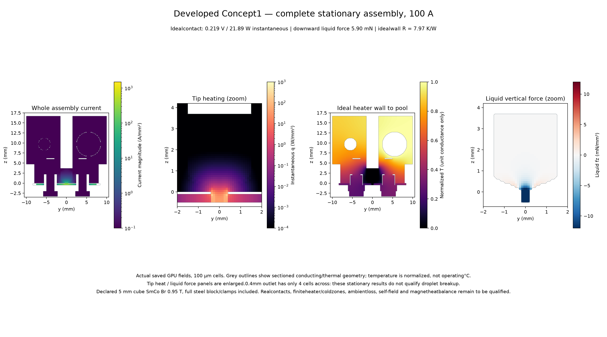
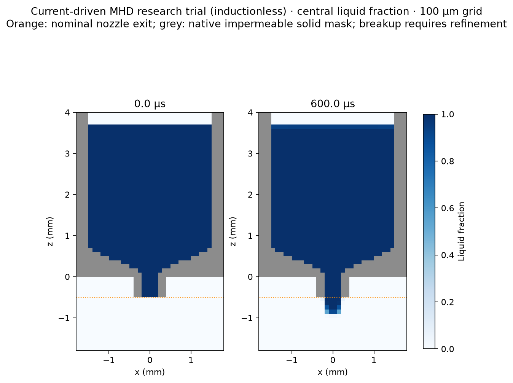
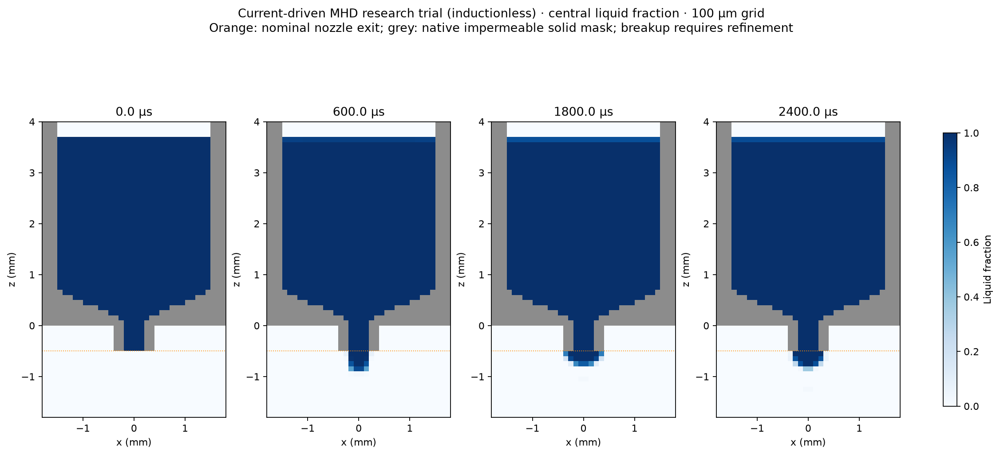
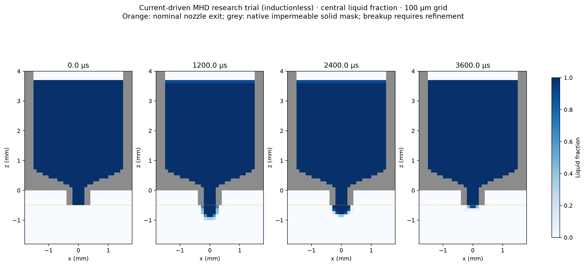

# Developed Concept1 — heater, sensor and insulated clamps

Authorized by Geoffrey topic25reply860. The source`/home/geoffrey/Reference/OffTopic/mhd-simulator/Concept1.blend` remains unchanged. Confirmed scale1BU=0.1mm. Developed editable copy:`hardware/designs/concept1-developed-v1/Concept1-developed.blend`; simulation project:`assembly-h0100.mhd.json` beside it.

1. The original3mm pool,0.4mm outlet and underside copper tip contacts are retained. The lower head's nominal profile was reconstructed to avoid Boolean slivers from the imported cylinder coordinates. Its symmetric difference from the cleaned source is0.00001535mm³; the original phase/profile/nominal dimensions have not been redesigned. The source has a0.6mm tapered transition from3mm to0.4mm, not an assumed118-degree drill taper. This must be specified as a suitable form tool/countersink in a manufacturing drawing.
2. A22x20x12mm upper stainless heater block is machined integrally with the head. The3mm feed bore continues to the top. Heater bore6.1mm diameter atY=5.5,Z=9.7 and sensor bore3.1mm atY=-5.5,Z=9.7 drill alongX; retaining screw envelopes are included. Nominal heater/feed inter-bore ligament0.95mm, heater top/bottom wall1.95mm. This is an envelope/machining concept, not a toleranced production drawing.
3. The heater has a6x20mm envelope, consistent with the [E3D standard heater drawing](https://devel.lulzbot.com/retail_parts/E3D_Dual_V3_Hotend_Kit_E1_KT-HE0004/E-HEATER-ALL_PUBLIC_Edition5.pdf). The3x15mm sensor envelope is documented in [E3D's104NT specification](https://e3d-online.com/pages/e3d-classics-support-104nt-thermistor). Actual selected parts, cold zones, heater retention/load, power and temperature limits remain to be qualified.
4. M2 clamp screws are insulated from copper at both head and shank using the [catalogued ceramic sleeve-washer](https://www.mcmaster.com/products/ceramic-shoulder-washers/) candidate92107A111: sleeve2.5mm long,3mmOD/2.1mmID, flange4.2mmOD/1.5mm thick. Copper/mica widen locally to4.8x5.2mm flat pads, with3.2mm clearance holes. The stainless counterbore leaves0.2mm nominal clearance under the sleeve end; M2x8 envelopes give3.8mm nominal thread engagement. Thermal expansion, compression, actual screw selection and tolerances remain open.
5. The original0.1mmmica sheet stays between copper and the head. Its tip opening leaves the intended vertical Cu/SS edge contacts. No conductive clamp path is intended through the upper body. Bolts and retaining screws remain in the model, so unintended current sharing can be checked.
6. Magnet faces move fromX=±2to±2.7mm. Each has0.2mm mica plus0.5mm air to the steel. The same5mm cube geometry is retained. Br0.95T, magnetization+X andmu_r=1 are declared screening assumptions; the user's original model did not specify magnetic grade. PositiveY current then gives negativeZ Lorentz force. Actual grade, carriers, cooling and magnet temperature remain unresolved; the gap is not a temperature qualification.
7. Clamp heads now extend2.8mm below the outlet plane. This increases minimum flat-target stand-off from the original magnet-limited2mm; additional carrier/target clearance must be allowed. Wires, lugs, heater leads and external grounded frame paths are unfinished.
8. Initial CPU checks show one connected steel part and no positive-volume overlaps; the actual loader accepts22 bodies. GPU voxelization also has zero overlaps. All current-carrying geometry fits the computation domain. Initial100A electrical/contact-sensitivity and ideal-bore-wall thermal screens completed; matched coupledflow trials are running. No jetting result yet.
9. The thermal screen includes finite SS/Cu/mica/ceramic conductivity but prescribes the whole heater-bore wall temperature. It omits finite cartridge power, cold zones/internal spreading, sheath/contact resistance, air/radiation, wire-feed demand, Joule heat and magnet/frame thermal balance. It measures ideal conductance only. Contact resistivity values are sensitivities, not measured joint quality.

## First completed assembly screens

| Cu/SS contact-resistivity scenario | Voltage at100A | Instantaneous heating | Downward liquid force |
|---|---:|---:|---:|
| Ideal0 |0.21885V |21.885W |5.897mN |
|1e-10Ωm² |0.28326V |28.326W |5.833mN |
|1e-9Ωm² |0.84749V |84.749W |5.775mN |

1. These are independent contact scenarios, not measurements or claimed hot-joint quality ranges. All charge/energy gates pass. The mean applied field in the liquid is0.1644T for the declared5mmcube/Br0.95T assumptions. The first nonnegativeY-plane liquid-current proxy is64.42A in the ideal case; this is not a unique through-current.
2. Ideal heater-bore-wall-to-poolG=0.125503W/K, R=7.96794K/W. This demonstrates a better ideal heat route than the earlier tall-plate assembly, not a finite-power operating heat balance. Thermal heat-return/energy errors pass and normalized temperatures stay[0,1].
3. Scaling the static cell-averaged heat by a250µs100A pulse,20µs rise/fall, followed after25µs by83.33µs at-25A gives226.875µs equivalent full-current heating time. With no heat spreading, the hottest stainless-cell estimates are8.76K ideal,11.16K low-contact and35.82K high-contact. These are grid-cell estimates from a static field, not predictions of microscopic contact flash temperature or safe pulse repetition. Sustained temperature and magnet heating remain unresolved.
4. A full-assembly coupled startup test accepted2steps at3µs, including pressure/interface motion and the current equation. GPU allocation fits. The matched1200step/3.6ms pair runs driven100A first, then0A, using the same pulse shape and250°C initial properties. Current conductivity updates with the moving interface and includes motionalEMF; forces are not frozen. Temperature evolution is disabled. The imposed-field/inductionless approximation omits current self-field and magnet reaction.
5. Both cases use100µm spacing, only4cells across the0.4mm outlet. They are startup/drop-response screens, not breakup qualification. First-step costs were about8–11seconds total, so the pair can take severalhours; no completion time is promised. Saved fields every0.6ms allow early inspection. The reporter uses the actual exitZ=-0.5mm.

## Partial flow result at 0.6 ms

1. The first accepted saved frame shows an attached protrusion approximately 0.35 mm below the nominal outlet, with 46.81 nL of liquid below the exit plane. The sampled outlet liquid velocity is 0.56 m/s downward. No detached component appears at alpha thresholds 0.01, 0.25, 0.5 or 0.75.
2. This is a running prefix, not the final outcome. The matched zero-current control has not started. No liquid reaches a domain boundary in this saved frame. The 100 µm spacing still prevents a trustworthy breakup or droplet-size claim.

## Partial flow result at 2.4 ms

1. The accepted 2.4 ms frame remains attached at all four connectivity thresholds. Below-tip liquid volume falls from 84.68 nL at 1.8 ms to 75.45 nL at 2.4 ms. The outlet-plane mean velocity changes to 0.243 m/s upward, indicating recoil.
2. The driven run is still active and the zero-current control remains queued. This is not a final failure/success finding or a grid-qualified breakup result. No liquid reaches the computational boundary in these saved frames.

## Completed driven flow screen at 3.6 ms

1. All 1200 steps completed. No detached region occurs in the saved frames at the four checked alpha thresholds. The attached bulge mostly retracts: below-exit volume falls from 84.68 nL at 1.8 ms to 9.89 nL at 3.6 ms; final outlet mean velocity is 0.688 m/s upward.
2. The matched zero-current control is now running. This remains a 100 µm response screen with four cells across the outlet, not a qualified breakup result.
3. Unit-current boundary imbalance is 3.99 ppm and motional imbalance 0.350 µA, within the declared 10 ppm / 1 µA criteria. The cumulative electrical-work identity has a signed relative defect of -0.000399810385 (399.8 ppm magnitude). This larger energy discrepancy is unresolved; completing steps is not equivalent to numerical qualification. Thermal evolution remains disabled.

