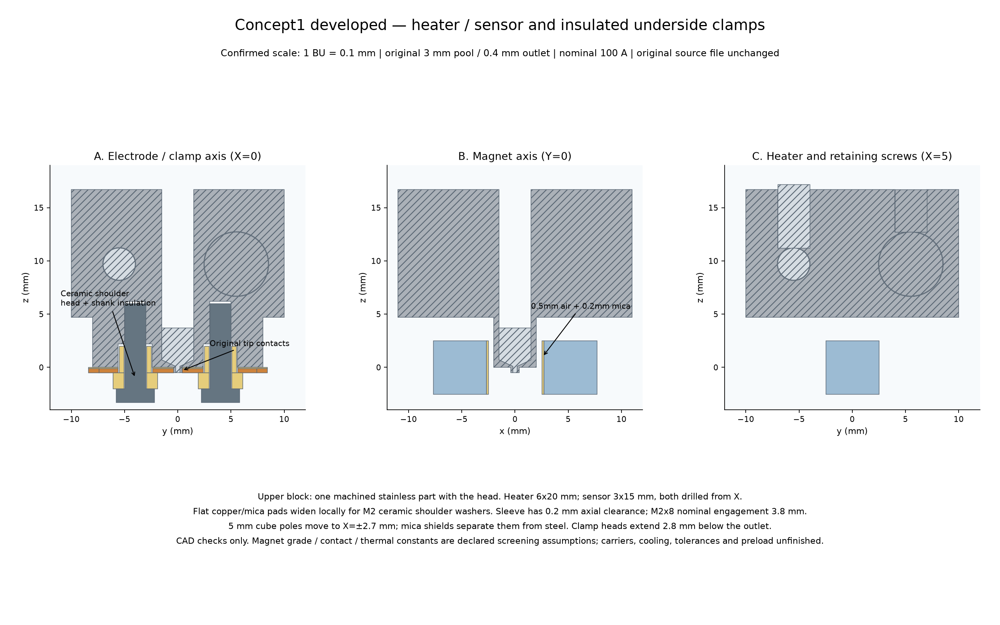

# Developed Concept1 — heater, sensor and insulated clamps

Authorized by Geoffrey topic25reply860. The source`/home/geoffrey/Reference/OffTopic/mhd-simulator/Concept1.blend` remains unchanged. Confirmed scale1BU=0.1mm. Developed editable copy:`hardware/designs/concept1-developed-v1/Concept1-developed.blend`; simulation project:`assembly-h0100.mhd.json` beside it.

1. The original3mm pool,0.4mm outlet and underside copper tip contacts are retained. The lower head's nominal profile was reconstructed to avoid Boolean slivers from the imported cylinder coordinates. Its symmetric difference from the cleaned source is0.00001535mm³; the original phase/profile/nominal dimensions have not been redesigned. The source has a0.6mm tapered transition from3mm to0.4mm, not an assumed118-degree drill taper. This must be specified as a suitable form tool/countersink in a manufacturing drawing.
2. A22x20x12mm upper stainless heater block is machined integrally with the head. The3mm feed bore continues to the top. Heater bore6.1mm diameter atY=5.5,Z=9.7 and sensor bore3.1mm atY=-5.5,Z=9.7 drill alongX; retaining screw envelopes are included. Nominal heater/feed inter-bore ligament0.95mm, heater top/bottom wall1.95mm. This is an envelope/machining concept, not a toleranced production drawing.
3. The heater has a6x20mm envelope, consistent with the [E3D standard heater drawing](https://devel.lulzbot.com/retail_parts/E3D_Dual_V3_Hotend_Kit_E1_KT-HE0004/E-HEATER-ALL_PUBLIC_Edition5.pdf). The3x15mm sensor envelope is documented in [E3D's104NT specification](https://e3d-online.com/pages/e3d-classics-support-104nt-thermistor). Actual selected parts, cold zones, heater retention/load, power and temperature limits remain to be qualified.
4. M2 clamp screws are insulated from copper at both head and shank using the [catalogued ceramic sleeve-washer](https://www.mcmaster.com/products/ceramic-shoulder-washers/) candidate92107A111: sleeve2.5mm long,3mmOD/2.1mmID, flange4.2mmOD/1.5mm thick. Copper/mica widen locally to4.8x5.2mm flat pads, with3.2mm clearance holes. The stainless counterbore leaves0.2mm nominal clearance under the sleeve end; M2x8 envelopes give3.8mm nominal thread engagement. Thermal expansion, compression, actual screw selection and tolerances remain open.
5. The original0.1mmmica sheet stays between copper and the head. Its tip opening leaves the intended vertical Cu/SS edge contacts. No conductive clamp path is intended through the upper body. Bolts and retaining screws remain in the model, so unintended current sharing can be checked.
6. Magnet faces move fromX=±2to±2.7mm. Each has0.2mm mica plus0.5mm air to the steel. The same5mm cube geometry is retained. Br0.95T, magnetization+X andmu_r=1 are declared screening assumptions; the user's original model did not specify magnetic grade. PositiveY current then gives negativeZ Lorentz force. Actual grade, carriers, cooling and magnet temperature remain unresolved; the gap is not a temperature qualification.
7. Clamp heads now extend2.8mm below the outlet plane. This increases minimum flat-target stand-off from the original magnet-limited2mm; additional carrier/target clearance must be allowed. Wires, lugs, heater leads and external grounded frame paths are unfinished.
8. Initial CPU checks show one connected steel part and no positive-volume overlaps; the actual loader accepts22 bodies. GPU voxelization also has zero overlaps. All current-carrying geometry fits the computation domain. Initial100A electrical/contact-sensitivity and ideal-bore-wall thermal screens are prepared; no jetting result yet.
9. The thermal screen includes finite SS/Cu/mica/ceramic conductivity but prescribes the whole heater-bore wall temperature. It omits finite cartridge power, cold zones/internal spreading, sheath/contact resistance, air/radiation, wire-feed demand, Joule heat and magnet/frame thermal balance. It measures ideal conductance only. Contact resistivity values are sensitivities, not measured joint quality.

