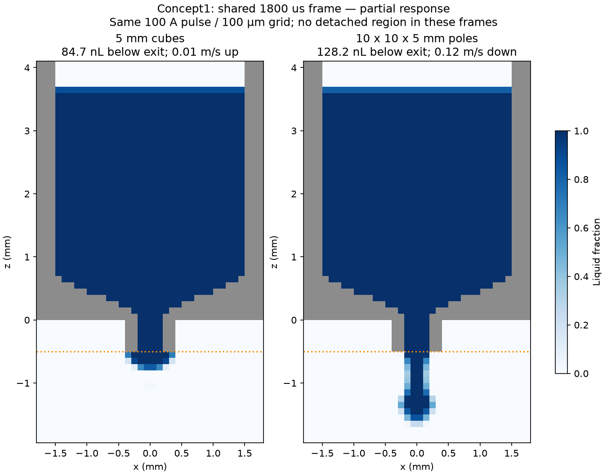
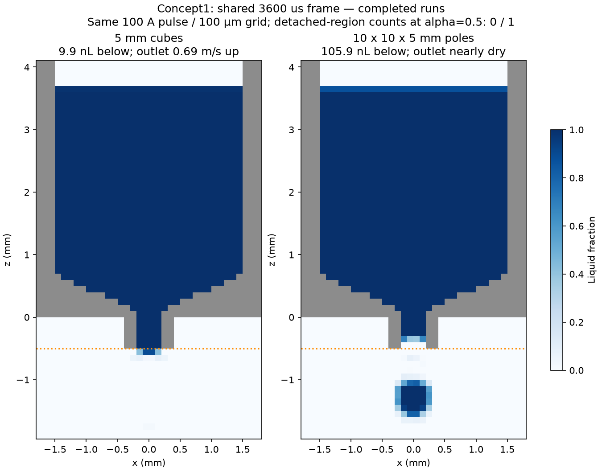
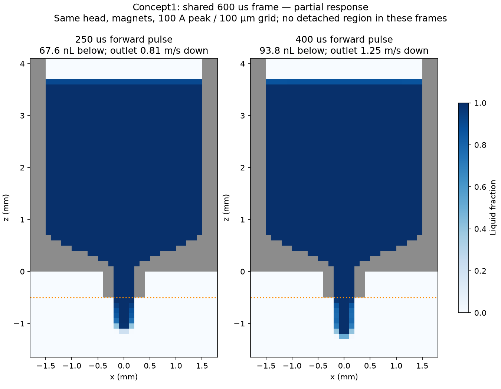
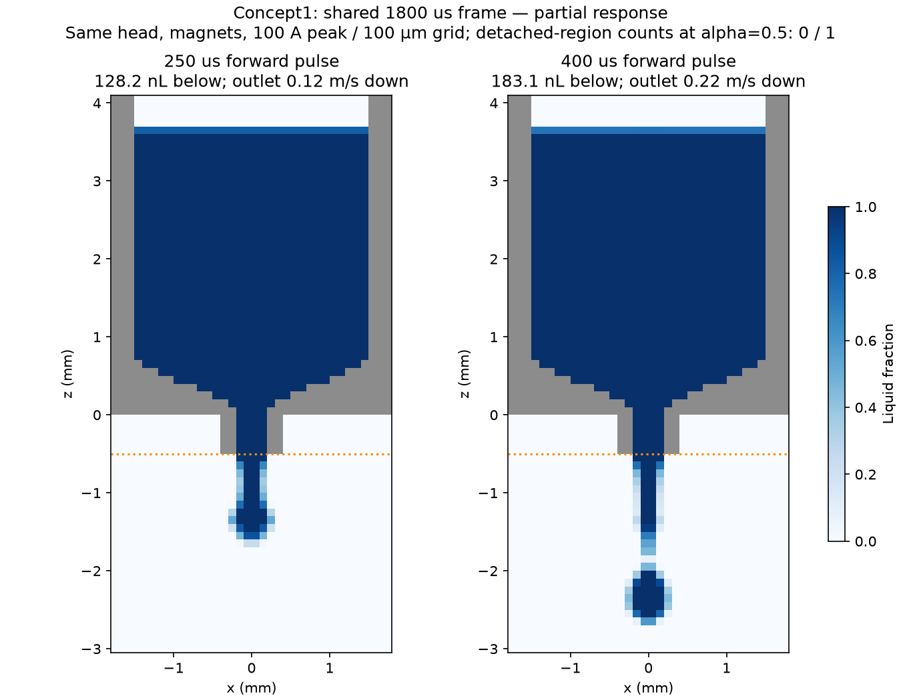
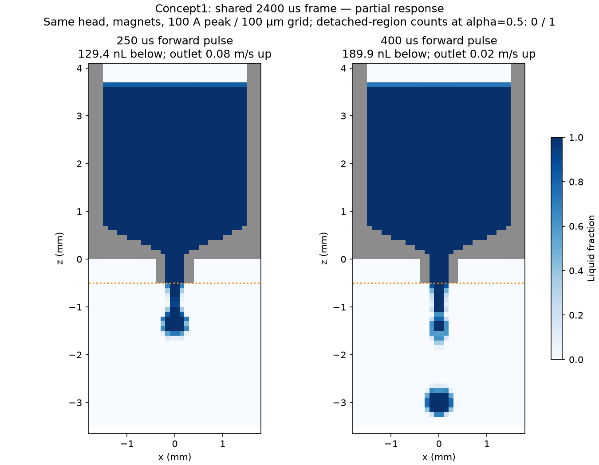

# Concept1 larger poles

1. User replies 870/871 cancelled the zero-current control and requested performance improvements. Its partial outputs are preserved; it will not be restarted.
2. This candidate changes only the magnet dimensions from 5 mm cubes to 10 x 10 x 5 mm (X/Y/Z). Inner faces stay at X=+/-2.7 mm, lower faces at Z=-2.5 mm. No increased flight obstruction. Same assumed Br=0.95 T and magnetization direction. Carriers and cooling remain unresolved.
3. All other geometry buffer bytes and all nonmagnet GPU occupancy masks are identical. Closed solids, CPU overlap checks and GPU zero-overlap checks pass. The unchanged air box crops only electrically isolated outer magnet occupancy; complete source meshes still generate the applied field.
4. A full-body stationary 100 A case is running first with the existing frozen conduction binary and strict charge/power checks. No improved jetting claim before actual fluid results. Same current/pulse fluid follow-up is authorized, conditional on this check.

## Completed stationary result

1. Near-outlet Bx increases from 0.2309 T to 0.3415 T. Downward liquid force increases from 5.897 to 8.759 mN, a factor of 1.485, at the same 100 A. Terminal voltage remains 0.218852 V and Joule power 21.8852 W.
2. Native charge and power gates pass. This is a stationary force comparison, not a prediction of detached drop size. The unchanged current solution is expected in this imposed-field DC calculation without motion.
3. A single driven fluid follow-up now runs with identical current/pulse/grid/timestep and the larger poles. No zero control is queued. The baseline 400 ppm electrical-energy mismatch remains unresolved and numerical qualification is not claimed.

## Partial matched-frame comparison at 0.6 ms

1. Larger poles produce an attached front approximately 0.55 mm below the exit, versus 0.35 mm with the cubes. Below-exit volume is 67.61 versus 46.81 nL, and mean outlet speed 0.812 versus 0.561 m/s downward.
2. Neither saved frame has detached regions at the four alpha thresholds. The larger-pole run is still active: this is an initial-response improvement, not a droplet-release result. Volume change is about 1e-9 relative and no liquid reaches a domain boundary in the new frame.

## Partial comparison at 1.8 ms

1. Larger poles: attached ligament reaches about 1.05 mm below the exit, with 128.22 nL below it and outlet mean velocity 0.123 m/s downward. Cubes: 84.68 nL and outlet mean velocity 0.0105 m/s upward, with the front only 0.25 mm below the exit.
2. No detached regions occur at any of the four checked thresholds in these saved frames. The new run continues; the ligament may still release or retract. Relative volume change is below 1e-9 and no domain-boundary liquid contact appears in the new frame.

## Partial pinch-off observation at 3.0 ms

1. The larger-pole case has one detached region at every checked alpha threshold (0.01/0.25/0.5/0.75). At alpha=0.5 its volume is 78.29 nL and equivalent diameter 0.531 mm; its mean velocity is 0.0326 m/s upward. Threshold-dependent diameters span 0.476–0.586 mm. It is not a demonstrated useful downward flight.
2. At 2.4 ms the region was still attached at every threshold. Saved frames bracket separation between 2.4 and 3.0 ms; they do not establish exact pinch-off timing. The 100 µm grid and unresolved electrical-energy defect still prevent qualification.
3. The original cubes have no detached region in the matched frame. The larger-pole run remains active through its requested 3.6 ms.

## Completed 3.6 ms result and next pulse

1. Both magnet-size cases completed1200steps. Larger poles retain one separated region at every threshold: alpha0.5 D0.53005mm,77.976nL, mean velocity0.00928m/s upward. This is a near-stationary released region rather than a useful downward jet. The original cubes have no separated region in any savedframe.
2. The larger-pole electrical-work identity defect is -336.1ppm (-1.662µJ), mostly during forward drive. It is comparable to the mechanical work0.906µJ, so mechanical-energy accuracy is unqualified despite the small fraction of Jouleheat. Unit-current defect is9.92ppm; the existing motion gate is a mixed10ppm-relative PLUS1µA allowance (peakabsolute1.070µA), not a hard1µA ceiling.
3. Next: same100A and geometry, positive duration400µs instead250µs; reverse remains25A but its width scales83.3->133.3µs with the client waveform. This increases net drive impulse. The analytic heating dose gives27.57Arms at assumed200Hz, not a repeated-run or heat-balance qualification. Charge requested residual tightens1e-6->1e-7 to address energy error; same PDE, grid, timestep and conservation gates. Nozero control.

## Longer-pulse numerical recovery

1. V1 stopped after8acceptedsteps (24µs): motional true residual1.0214e-7 narrowly missed1e-7 at the4000iteration cap; boundary imbalance9.1e-11A passed. Outputs are preserved; no jetting inference is possible.
2. V2 uses the same physics and numerical tolerances with a12000iteration cap. The original4000 default remains for other callers. A new separately named binary preserves the old frozen binary. No convergence or conservation limit is relaxed.
3. All9headless numerical tests pass. The long-path analytical test additionally rejects a32iteration budget and converges with a larger configured budget while retaining current/power checks. Actual Concept1 convergence at1e-7 remains to be demonstrated by V2.

## Screening tolerance restored (human879)

1. V2 also stopped at24µs despite12000iterations: true residual1.01447e-7 vs1e-7, zero reported terminal imbalance. This is consistent with stagnation near the arithmetic floor, rather than insufficient iteration count; its exact origin is not established. Both failed attempts remain preserved.
2. The performance screen now uses the original frozen Concept1 binary and1e-6 residual, as for the completed250µs reference. The400µs pulse,100Apeak, geometry/grid/timestep and conservation gates are retained. No claim that residual equals physical accuracy; the electrical energy limitation stays recorded.
3. This V3 comparison now changes waveform duration alone relative to the completed larger-pole250µs baseline. Nozero control or strict-tolerance repeat is queued.

## 400 µs partial response and host interruption

1. V3 passed the strict-attempt failure point on its restored1e-6screening setting. Its saved0.6msframe remains attached at all thresholds:93.82nL belowexit, outlet1.246m/sdown, front0.75mmbelowexit. The250µs reference has67.61nL,0.812m/sdown and0.55mmfront at the same time.
2. Host restart interrupted V3: at06:41NZDT22Nov, uptime was28min, all three originalPIDs were absent, and no terminalrunstatus existed. Lastlog240steps720µs; lastacceptedexport200steps600µs. The saved partial result remains usable, but the run did not complete.
3. V4 restarts in fresh outputs with identical geometry, waveform, grid, timestep,1e-6residual and originalbinary; no physics change. V3 outputs/state are preserved as interrupted.

## 400 µs partial response at 1.8 ms (V4)

1. A dense region is separated at alpha0.25/0.5/0.75 but remains connected at0.01. At0.5 it is83.265nL, D0.54178mm, moving1.108m/s downward; threshold-dependent dense-region diameters0.516–0.569mm. This is not yet threshold-robust free flight.
2. Total liquid belowexit183.10nL includes the trailing ligament as well as the dense bulb; it is not droplet volume. The leading front reaches2.15mm belowexit. No liquid touches a domain boundary in the saved1.8msframe; relative volume change1.15e-8.
3. The lower domain boundary is Z=-3.5mm, so the leading drop will approach it before the requested3.6ms endpoint. Later wall interaction must be identified rather than mistaken for jet physics. Extra flight space is a candidate next numerical-domain change after this run, not a geometry improvement. No additional GPU job is queued.

## Pre-contact separation at 2.4 ms

1. One leading region is separated at all four thresholds. At alpha0.5 it is90.44nL, D0.55692mm and1.07359m/s downward; threshold diameters0.529–0.581mm and speeds1.069–1.079m/sdown. No liquid touches the computational boundary in this savedframe (maximum lowerboundaryalpha7.9e-9). The leading center is Z=-2.979mm.
2. By3.0ms the leading region contacts the lowerboundary (Z=-3.5mm); its later speed/shape are boundary-affected. A second dense trailing region is threshold-dependent at that point, so a clean-single-drop outcome is not established.
3. A CPU-only follow-up project extends lowerZ to-8.5mm with all other configuration identical. GPUpreflight and memory check must follow after the currentrun exits. No newGPUcase is queued yet. This provides flightspace rather than changing hardware.

## Completed short-domain pulse screen and extended-domain follow-up

1. V4 completed1200steps3.6ms. Observed pulse dose corresponds to27.569A RMS at assumed200Hz, peak terminalvoltage0.218870V, Jouleheat8.2485mJ. The energyidentity defect is-315.5ppm (-2.602µJ), still comparable to2.290µJ mechanicalwork; performance/energy qualification remains limited. Unit-current defect3.99ppm and peakmotional imbalance0.928µA are within the stated criteria.
2. Firstsaved boundarycontact is3.0ms; lastnoncontactframe2.4ms shows the separated leadingdrop reported above. Finalleadingdrop shape/speed and trailingdrop behaviour cannot be treated as unaffected freeflight.
3. Extended-domain GPUpreflight passes:224x204x259, zerooverlap, the original209planes shifted50planes have byte-identical bodymasks, addedspaceempty. LinearworkingVRAMestimate5174MiB vs6144MiB device capacity; actualfullsolverstartup remains monitored. The same400µs pulse is running in this domain, with no hardware/resolution/timestep/tolerance change.

## Flightspace startup computation cap

1. The first extended-domain attempt was blocked beforefluidsteps by the default50billion directsource-interaction cap. This was not a pressure/current convergence failure or an actual memory-allocation failure. Its state/log/output remain preserved.
2. A fresh V2 permits75billion interactions, preserving the50billion default for normal callers. All sourcequadrature, field kernels, geometry, conductivity, pulse and memoryguards are unchanged; only permitted startupwork grows. The new separately named binary preserves all older frozenbinaries.
3. The GPU analyticmagnet-prism test passes, rejects an insufficientworkbudget, and returns bit-identical magneticfield with default versus enlargedcap. Three pulse-scheduling CPUtests also pass. Actual largedomain solverfit/acceptedsteps remain monitored.
