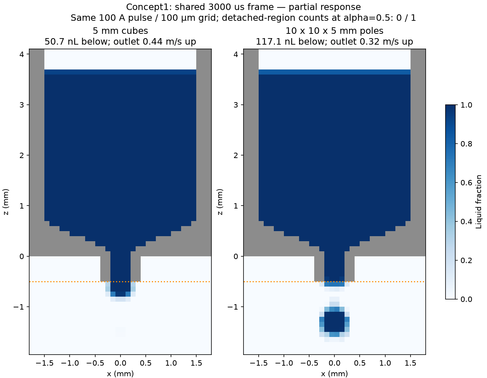

# Concept1 larger poles

1. User replies 870/871 cancelled the zero-current control and requested performance improvements. Its partial outputs are preserved; it will not be restarted.
2. This candidate changes only the magnet dimensions from 5 mm cubes to 10 x 10 x 5 mm (X/Y/Z). Inner faces stay at X=+/-2.7 mm, lower faces at Z=-2.5 mm. No increased flight obstruction. Same assumed Br=0.95 T and magnetization direction. Carriers and cooling remain unresolved.
3. All other geometry buffer bytes and all nonmagnet GPU occupancy masks are identical. Closed solids, CPU overlap checks and GPU zero-overlap checks pass. The unchanged air box crops only electrically isolated outer magnet occupancy; complete source meshes still generate the applied field.
4. A full-body stationary 100 A case is running first with the existing frozen conduction binary and strict charge/power checks. No improved jetting claim before actual fluid results. Same current/pulse fluid follow-up is authorized, conditional on this check.

## Completed stationary result

1. Near-outlet Bx increases from 0.2309 T to 0.3415 T. Downward liquid force increases from 5.897 to 8.759 mN, a factor of 1.485, at the same 100 A. Terminal voltage remains 0.218852 V and Joule power 21.8852 W.
2. Native charge and power gates pass. This is a stationary force comparison, not a prediction of detached drop size. The unchanged current solution is expected in this imposed-field DC calculation without motion.
3. A single driven fluid follow-up now runs with identical current/pulse/grid/timestep and the larger poles. No zero control is queued. The baseline 400 ppm electrical-energy mismatch remains unresolved and numerical qualification is not claimed.

## Partial matched-frame comparison at 0.6 ms

1. Larger poles produce an attached front approximately 0.55 mm below the exit, versus 0.35 mm with the cubes. Below-exit volume is 67.61 versus 46.81 nL, and mean outlet speed 0.812 versus 0.561 m/s downward.
2. Neither saved frame has detached regions at the four alpha thresholds. The larger-pole run is still active: this is an initial-response improvement, not a droplet-release result. Volume change is about 1e-9 relative and no liquid reaches a domain boundary in the new frame.

## Partial comparison at 1.8 ms

1. Larger poles: attached ligament reaches about 1.05 mm below the exit, with 128.22 nL below it and outlet mean velocity 0.123 m/s downward. Cubes: 84.68 nL and outlet mean velocity 0.0105 m/s upward, with the front only 0.25 mm below the exit.
2. No detached regions occur at any of the four checked thresholds in these saved frames. The new run continues; the ligament may still release or retract. Relative volume change is below 1e-9 and no domain-boundary liquid contact appears in the new frame.

## Partial pinch-off observation at 3.0 ms

1. The larger-pole case has one detached region at every checked alpha threshold (0.01/0.25/0.5/0.75). At alpha=0.5 its volume is 78.29 nL and equivalent diameter 0.531 mm; its mean velocity is 0.0326 m/s upward. Threshold-dependent diameters span 0.476–0.586 mm. It is not a demonstrated useful downward flight.
2. At 2.4 ms the region was still attached at every threshold. Saved frames bracket separation between 2.4 and 3.0 ms; they do not establish exact pinch-off timing. The 100 µm grid and unresolved electrical-energy defect still prevent qualification.
3. The original cubes have no detached region in the matched frame. The larger-pole run remains active through its requested 3.6 ms.

