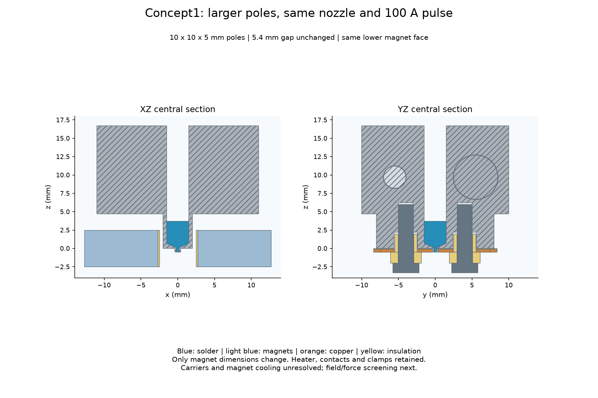

# Concept1 larger poles

1. User replies 870/871 cancelled the zero-current control and requested performance improvements. Its partial outputs are preserved; it will not be restarted.
2. This candidate changes only the magnet dimensions from 5 mm cubes to 10 x 10 x 5 mm (X/Y/Z). Inner faces stay at X=+/-2.7 mm, lower faces at Z=-2.5 mm. No increased flight obstruction. Same assumed Br=0.95 T and magnetization direction. Carriers and cooling remain unresolved.
3. All other geometry buffer bytes and all nonmagnet GPU occupancy masks are identical. Closed solids, CPU overlap checks and GPU zero-overlap checks pass. The unchanged air box crops only electrically isolated outer magnet occupancy; complete source meshes still generate the applied field.
4. A full-body stationary 100 A case is running first with the existing frozen conduction binary and strict charge/power checks. No improved jetting claim before actual fluid results. Same current/pulse fluid follow-up is authorized, conditional on this check.

## Completed stationary result

1. Near-outlet Bx increases from 0.2309 T to 0.3415 T. Downward liquid force increases from 5.897 to 8.759 mN, a factor of 1.485, at the same 100 A. Terminal voltage remains 0.218852 V and Joule power 21.8852 W.
2. Native charge and power gates pass. This is a stationary force comparison, not a prediction of detached drop size. The unchanged current solution is expected in this imposed-field DC calculation without motion.
3. A single driven fluid follow-up now runs with identical current/pulse/grid/timestep and the larger poles. No zero control is queued. The baseline 400 ppm electrical-energy mismatch remains unresolved and numerical qualification is not claimed.
