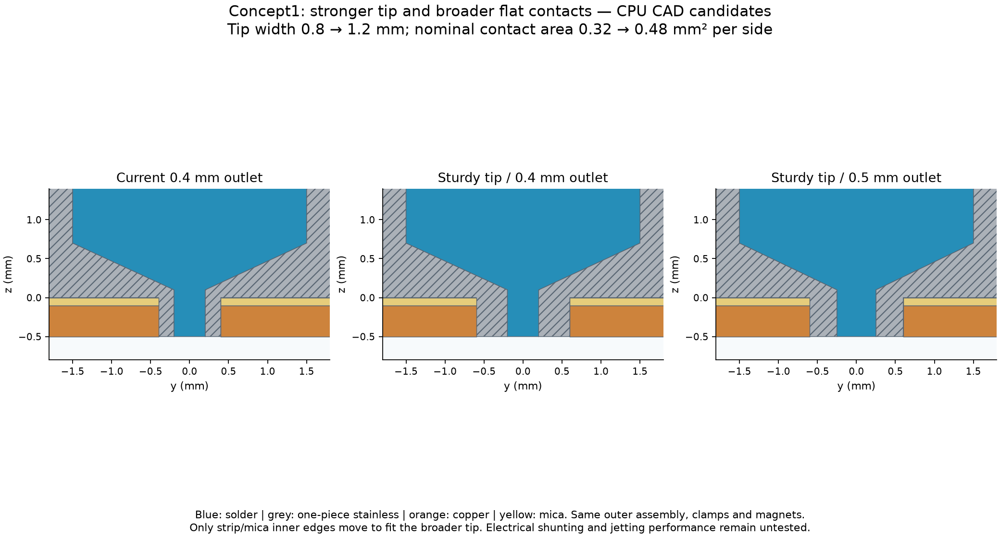
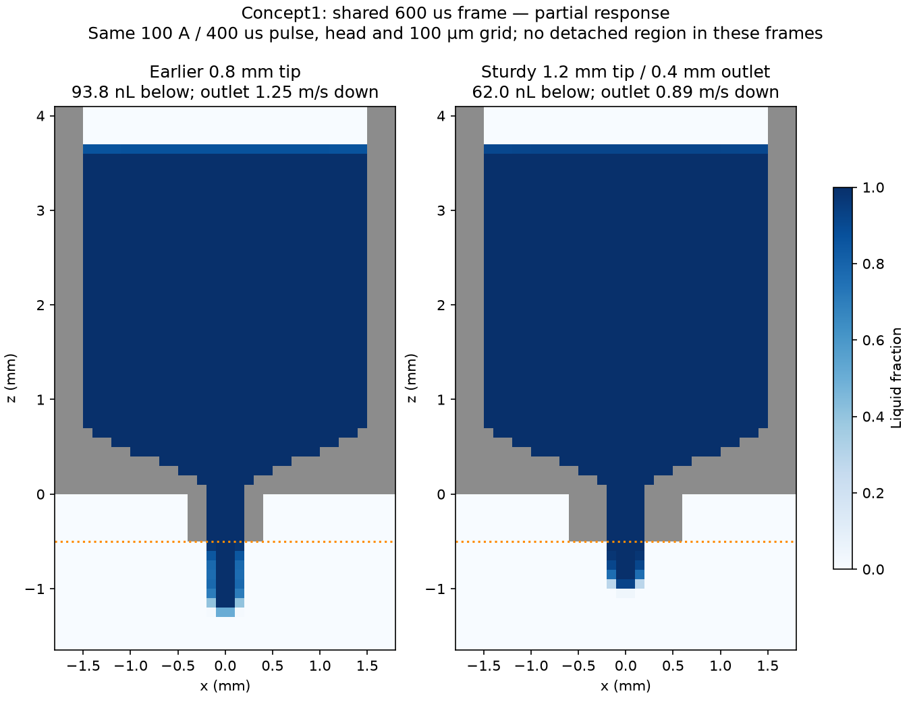
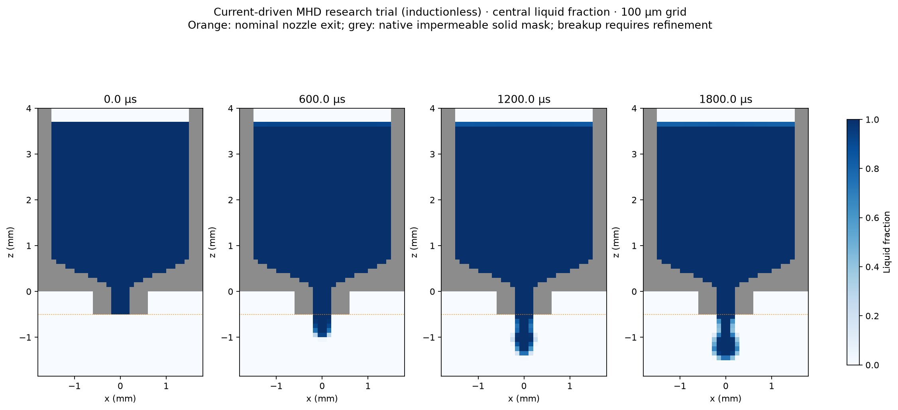
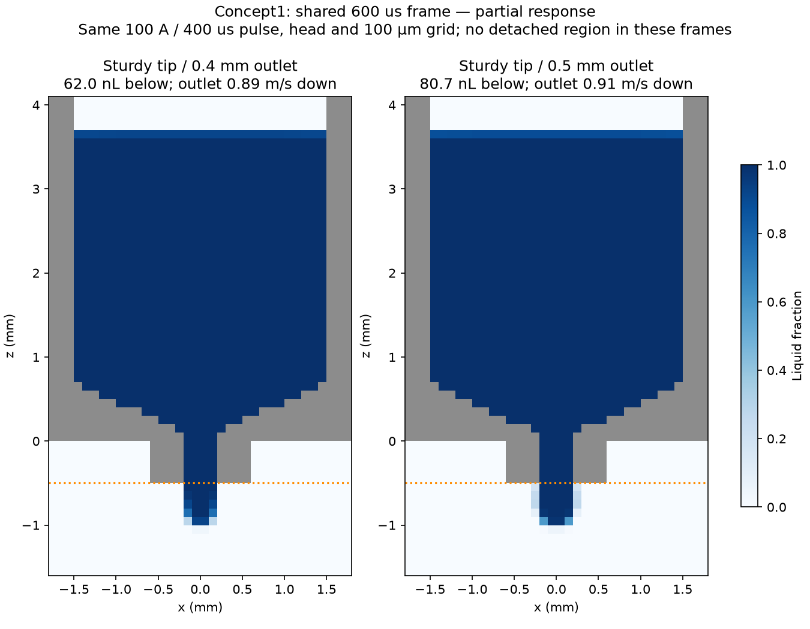
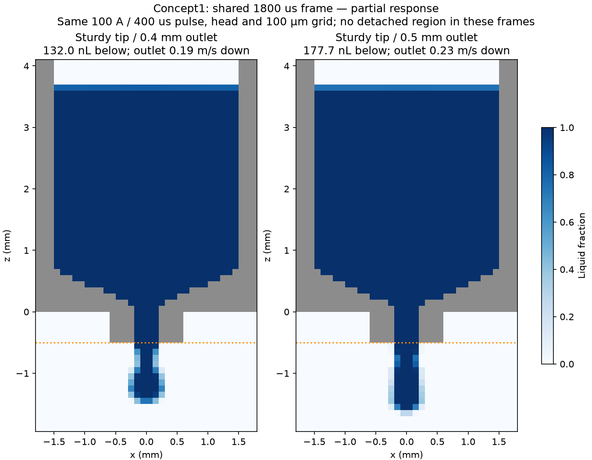
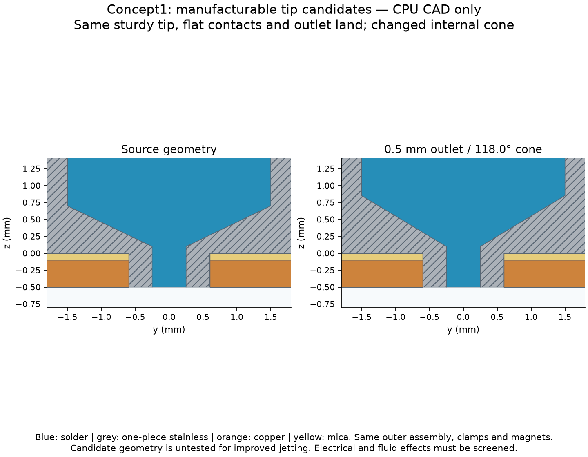
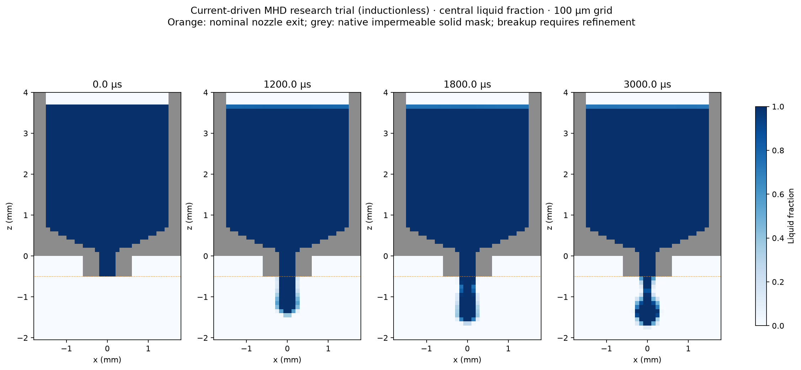
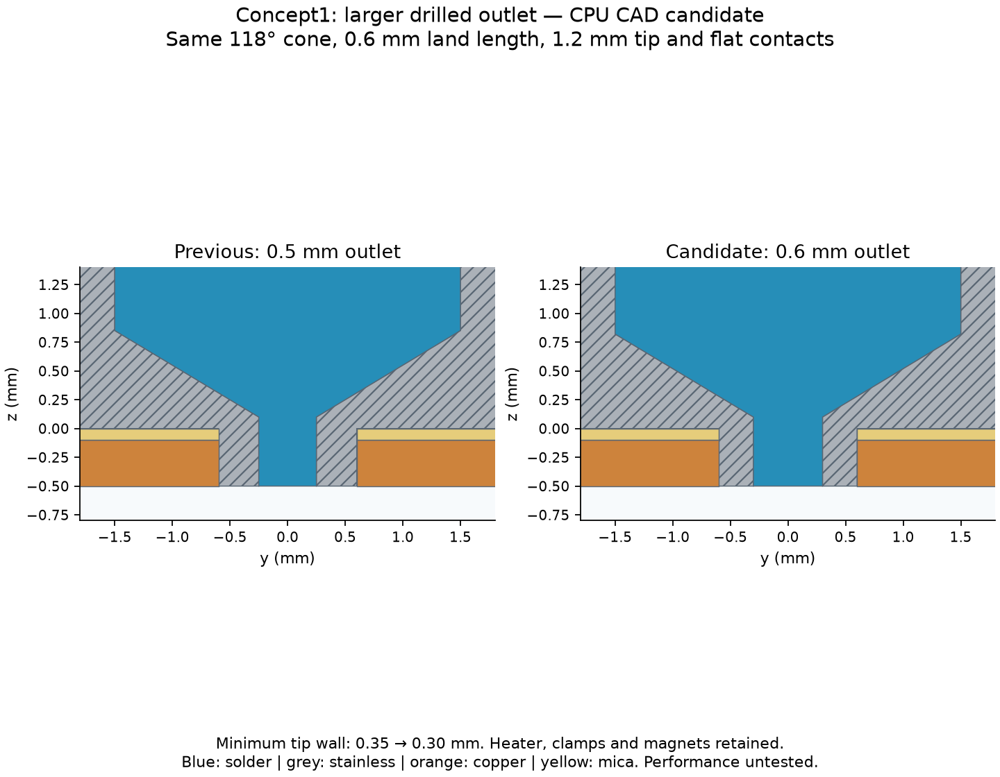

# Sturdy Concept1 tip candidates

1. User911 prioritizes geometric improvements over extended verification. The flightspace comparison was stopped at its last logged530steps1.59ms, preserving partial outputs; no further verification cases are queued.
2. Both candidates widen the squaretip from0.8to1.2mm and move the copper/mica inneredges0.2mm outward. Straightland stays0.6mm. The0.4mmexit leaves0.4mmwall;0.5mmexit leaves0.35mmwall. NominalCuSScontact grows0.32->0.48mm2per side. The heater, clamps, magnets and all other mesh payloads stay unchanged.
3. CPUclosedsolid/one-pieceSS/overlap checks and both initialGPUzerooverlap checks pass. These are minimal setupchecks. Brief100Acurrent/force/Joulescreens run sequentially before selecting a fluidcandidate.
4. BroaderSSmaybypassliquidcurrent, and thelargerexit maygrowdrops/tails. Neitherdesign has a jetting result yet. Sourceproperties/contact/thermal limits from theConcept1baseline continue to apply.

## Brief100A screen results

1. Currenttip:0.21885V/21.885W/downwardliquidforce8.759mN. Sturdy0.4mm:0.19548V/19.548W/11.777mN (+34.5%force). Sturdy0.5mm:0.19425V/19.424W/12.653mN (+44.5%force). These are stationary calculations, not detached-drop results.
2. The0.4mmsturdycandidate is selected first for a100A400µs fluid experiment, retaining the previousoutletdiameter and pulse while improving the manufacturablewall/contactdimensions. The0.5mmcandidate stays ready for subsequent performance experiments. No extra verification runs are queued.

## Fluid startup mesh repair

The first040fluid attempt stopped beforetimestepping: CADsubcell integration rejected invalidorientedlengths. CPUclosedsolids and coarseGPUoccupancy hadpassed; the Booleanagainstimportedf32steel likely introduced tinyfaceartifacts. Staticgridresults remain coarsegeometryscreens, nofluidresult. The nominalshape is being rebuilt fromanalytic primitives in freshv2files; oldinputs/outputspreserved.

Analyticv2CAD preserves the nominaltip dimensions. The040repairedmesh has zeroGPUoverlap and byte-identical coarse bodymasks to the screenedv1geometry, with the same magnetic sources. The staticcurrent/force screen therefore remains applicable to this discretegrid; it was not repeated. The040fluidexperiment now uses the repairedv2input.

The repaired040case has now completed CADfractioninitialization and published its initialacceptedframe; its fluidrun subsequently passed moving exports and was stopped early for the next geometry. Geometry/performance remains the priority, with no furtherdomain/accuracycomparison queued.

## First moving040frame and force location

1. At0.6ms the sturdytip has61.99nLbelowexit and0.89175m/sdownward outletflow, versus93.82nL/1.24567m/s for the earlier0.8mmtip in the sameflightdomain/pulse. All connectivitythresholds remain attached. This is an earlyresponse comparison, not the finaldrop result.
2. A read-only breakdown of savedstationaryfields finds that force in the straightoutlet falls4.856->2.548mN while taperforce rises1.986->4.093mN and upperpoolforce1.917->5.136mN. Thus the greaterintegratedforce is distributed fartherupstream; this is consistent with weaker earlyoutletmotion, though not a complete causalpressure decomposition.
3. The0.5mmbore has3.484mN in its straightoutlet in thatscreen and lower hydraulicresistance is expected. It is the preparednextgeometrycandidate, subject to current040drop/tail results. No newverificationcase is queued.

## Partial040 screening decision and050 launch

1. At1.8ms the040 ligament remains attached at alpha0.01/0.25/0.5/0.75. Below-exit liquid132.007nL; outlet mean velocity0.19052m/s downward, front0.95mm belowexit, no boundary contact. Stopped at1.98ms to prioritize geometry performance per human911. This partial screen does not prove no later release. Raw fields are preserved.
2. The050 repaired mesh passes zero-overlap and all coarse bodymasks match its prior stationaryscreen exactly. No repeated fieldsolve. A fresh050 fluidrun now uses the same100A400us waveform/settings; only outletgeometry differs from040. Static force alone is not a jetting claim.

## First050 moving-frame comparison

At0.6ms the0.5mm outlet has80.71nL belowexit versus61.99nL for0.4mm (+30.2%), with similar downward outlet velocities0.90687 versus0.89175m/s. Both remain attached at all four connectivity thresholds, with no boundary contact. This is more initial expelled volume, not evidence of a released drop. The050run continues to assess release/tail performance.

At1.2ms the050run remains attached at all thresholds:144.947nL belowexit versus108.983nL for040, downward outlet speed0.47439 versus0.46282m/s, with no boundary contact. This continues the larger-volume/similar-speed trend; release is still pending. See the saved step400 comparison.

## 1.8ms geometry decision and118-degree cone candidate

1. The050prefix has177.727nL belowexit, downward outlet speed0.23479m/s, front1.05mm belowexit; no detached region at any of four thresholds and no boundary contact. The040prefix at the same time has132.007nL,0.19052m/s and0.95mm extension. Allow one more useful frame to assess the larger ligament, rather than a verification campaign.
2. CPU-prepared candidate `concept1-sturdy-tip-drill118-v1-050` changes only steel/liquid cone geometry:128.7° to118°, increasing transition length0.600 to0.75108mm. Outlet0.5mm, land0.6mm, tip1.2mm/wall0.35mm, contacts and all other meshes retained. It offers a conventional drill-point shape; performance improvement is unproven. CPUloader, one-piece steel and no-overlap checks pass; GPUpreflight and brief100A screen wait for the active flow to exit.
3. `cad-drill118-v1/screen-plan.json` is prepared only, not queued. No added refinement/domain/precision tests. An initial incomplete generator output was preserved under artifacts/cases/drill118-incomplete-generator after source-template naming differed; it was never simulated.

## Stopped050 and118-degree flow test

1. At2.4ms the050ligament remains attached,191.596nLbelowexit, outletdown0.0489m/s. At3.0ms it remains attached at all thresholds and recoils:188.607nL, outletup0.08828m/s, no boundary contact. Stopped near3.12ms to pursue the next geometry; this partial result does not prove no eventual release.
2. The118-degree cone passes GPUoverlap (zero;620liquid->steelchangedcells, allotherbodymasksidentical) and brief100Aelectrical gates. Voltage0.1945008V, Joule19.4500W, totaldownforce12.3837mN versus12.6535baseline; straightoutlet3.50238 versus3.48385mN. See cad-drill118-v1/screen-results.json. These are stationary forces, not jetting predictions.
3. A fresh118-degree fluidrun now uses exactly the previous050waveform/numerics; its actual response remains pending. Plans and binaries are frozen. No verification or accuracy campaign.

At0.6ms the118-degree cone has80.631nL belowexit and downward outlet speed0.91283m/s, versus80.711nL and0.90687m/s for128.7degrees. Both remain attached at all thresholds, samefront0.45mm belowexit, no boundary contact. Thus there is no material earlyresponse improvement; release remains pending. Actual first-frame comparison was visually checked.

## Host interruption and0.6mm outlet candidate

1. Hostreboot on23November10:41NZDT interrupted the118-degree0.5mmrun after330steps0.99ms; only0.6ms movingframe saved, earlyresponse almostidentical to129-degreecone. Controller/native/sampler absent; oldstate markedinterrupted_host_restart, outputs preserved. It was not restarted.
2. Newcandidate0.6mmoutlet retains118-degreeconeangle,0.6mmstraightland,1.2mmsquaretip andallcontacts/heater/magnets/clamps. Minimumtipwall0.30mm. Only steel/liquid geometry changes. CPUonepiece/nooverlap/loader/payload/settingschecks pass; GPUzerooverlap292steel-to-liquidcells, all otherbodymasks identical. CADshown985beforeelectricaltest.
3. Brief100Astatic result:0.189578V,18.9577W,totaldownforce15.7545mN,straightoutlet7.0752mN versus3.5024mN for0.5mm. The coarse mask crosssection changes0.16to0.32mm2 despite nominalarea increase1.44x, so this is not a converged physical doubling. Screen passes establishednativegates; no additionalverificationrun.
4. Fresh0.6mmfluidrun started withsame100A400uswaveform/numerics, sixcellsacrossoutlet. Response/releaseunproven. See cad-drill118-060-v1/screen-results.json and flow-plan.json.

