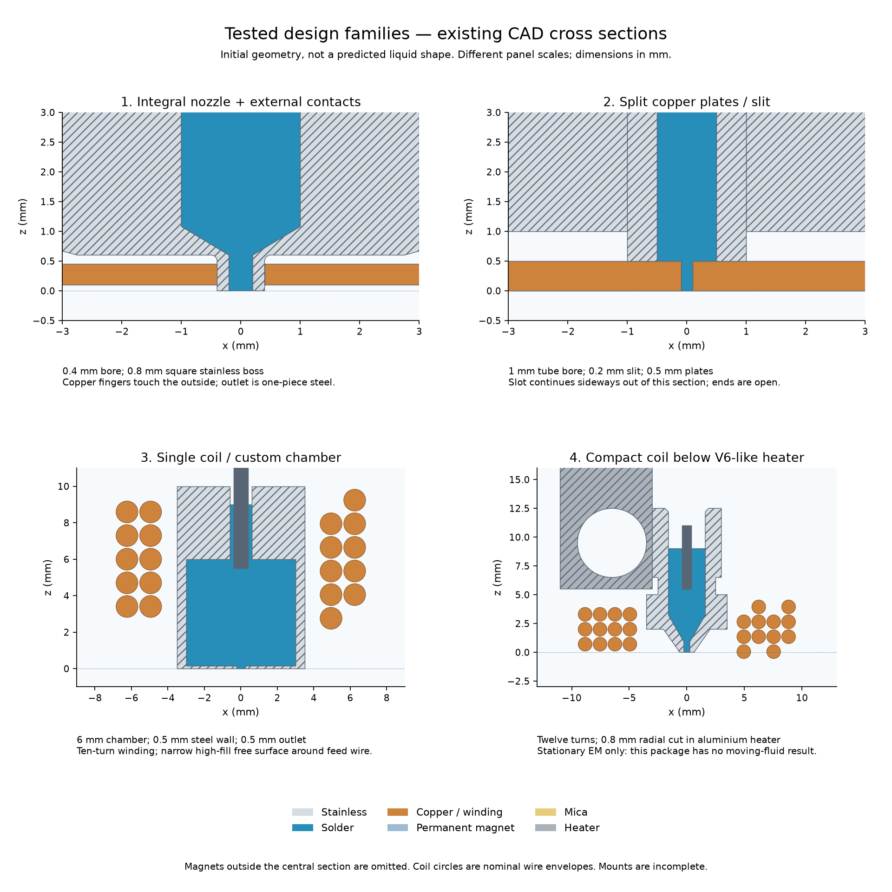
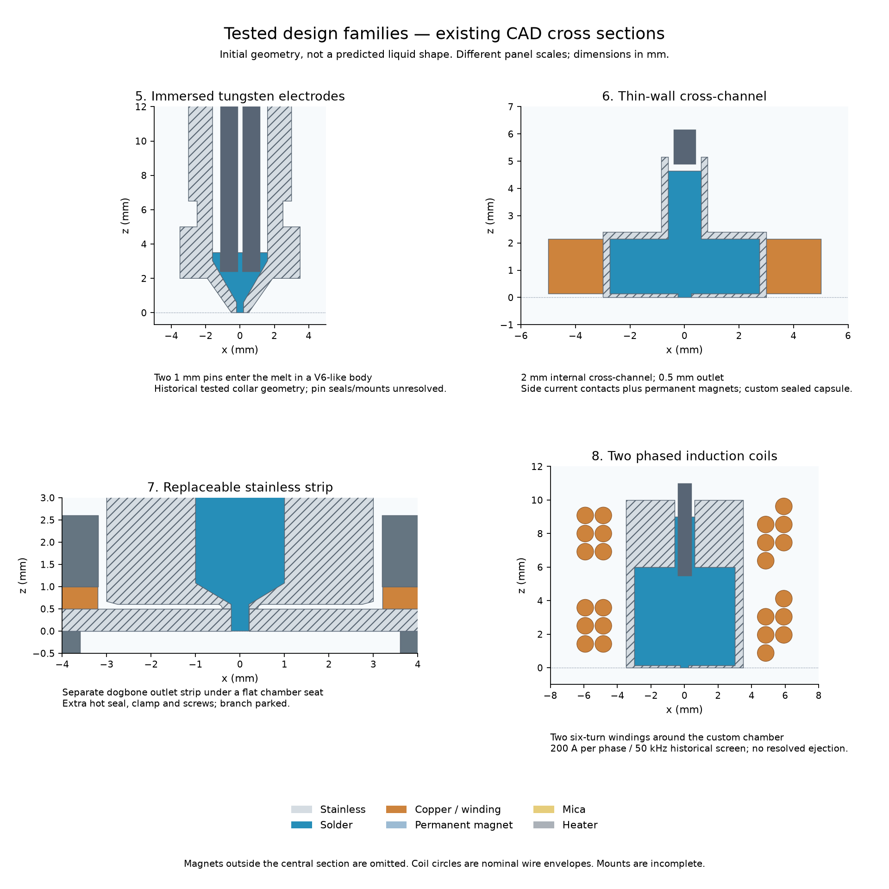

# Design comparison for the next hardware discussion

**Draft: awaiting the already-running high-fill coil case. Do not publish as the final comparison yet.** Prepared in response to topic 19, reply 774. New experiments are on hold under reply 772. Figures are existing CAD sections rendered without a new simulation; panel numbers match the items below.

The strongest current prototype candidate is **the integral stainless nozzle with external copper contacts and permanent magnets**. The slit is the lower-current challenger. No design has established clean, repeatable operation at hundreds of droplets per second. All ejection described below is simulated, not a physical bench result.

Voltages below distinguish the head load from its supply rail. Direct-contact head voltages omit the inductive voltage needed to change current and, unless stated, external leads. A 24 V regulated bridge can have ample compliance despite a sub-volt load; that is not a completed circuit design. RMS figures assume repeating the recorded pulse at 200 Hz, not a demonstrated repetition rate.

1. **Integral stainless nozzle / external tip contacts — preferred practical candidate.** The M6 body and 0.4 mm outlet are one stainless part, with a 0.8 mm square boss, 0.2 mm walls and R0.1 root. External copper fingers apply current across the tip in a permanent field. At **110 A for 250 µs**, the fine 50 µm case produces a **0.596 mm leading drop at 0.889 m/s downward**, but also a roughly 0.417 mm secondary region. This is encouraging ejection, not clean single-drop release. The coarse reverse-55 A variant gives a 0.521 mm leading region and another dense trailing region. Its command dose corresponds to **24.0 A RMS at 200 Hz**. Modelled head voltage peaks near **0.182 V**; a separate ideal-joint, long-lead fixture gives **0.83 V resistive drop at 110 A**. Adding roughly 1 µH of loop inductance requires another 5.5 V during a 20 µs rise. Manufacture is moderate: turn/drill the M6 body, machine the small boss/flats, clamp two heated copper fingers with mica insulation, and retain four stock-sized SmCo bars. Magnets project about 2 mm below the outlet before adding a carrier. There is no separate liquid-pressure seal at the tip. **Main risk:** assumed liquid/steel interface resistivity of 10⁻⁹ Ω·m² removes ejection at 110 A. Actual wetting/current transfer, dry joints and full-heater shunting are unresolved. A separate ideal single-shot thermal replay peaks at 261 °C from 250 °C; it does not qualify repetitive heating. [Geometry/thermal](m6-rooted08-screening.json), [fine flow](m6-rooted-flow-refinement-screening.json), [reverse pulse](rooted-retract-screening.json), [interface sensitivity](rooted-interface-screening.json).

   The simpler stock-V6-like external-contact variant also produced approximately **0.600 mm / 0.180 m/s** at **200 A / 250 µs** in a gravity-on coarse case. Its 200 Hz current budget is about 43 A RMS, above the desired thermal target; finer runs change size and velocity substantially. The machined near-flush magnet variant reduced the demonstrated coarse peak to 175 A. These are alternatives within the same architecture, not more mature operating points. [Earlier comparisons](README.md#earlier-candidates-and-completed-controls).

2. **Straight tube / split copper slit plates — promising secondary candidate.** A **1 mm ID / 2 mm OD tube** sits above two 0.5 mm copper plates separated by a **0.2 mm slot**. This avoids drilling a tiny outlet through a complex body. **40 A for 1 ms**, followed by reverse 10 A, produced a provisional **0.408 mm region moving down at 0.90 m/s** in the last saved 9.519 ms field. Recorded head voltage peaks at **0.0205 V**, excluding external leads; the accepted command dose is **17.82 A RMS at 200 Hz**. However, the run **failed its CFL guard at 9.999 ms**, and approximately **189 nL spread outside the bore footprint**, versus 35.5 nL in that drop. The completed unpowered control produced no drop. Manufacture has a simple bore and flat plates, but controlling slot width, lateral confinement and the hot tube/plate seal remains difficult. Alumina could be an off-the-shelf straight tube; the tested stainless version avoids ceramic sourcing. Integral stainless end walls and mica end shims are **CAD-only follow-ups**, with no new DC or flow result. [Accepted-prefix evidence](split-slit-conditioned-prefix-screening.json), [CAD and scope](designs/split-slit-review/README.md).

3. **One external coil / custom chamber — simplest electrical connection, unproven jetting.** The tested chamber has **6 mm ID, 0.5 mm radial steel walls, a 0.5 mm aperture and 0.15 mm exit land**, surrounded by a ten-turn coil. The best electrically screened single pulse is **250 A, 10 µs rise / 100 µs fall**, with approximately **29 V loaded peak** and **21.4 A RMS at 200 Hz**. This fits a nominal 48 V compliance envelope, subject to a real driver and cooling design. The completed lower-fill 0/250 A flow pair produces no detached region through 2.1 ms. The V6-like coil pair also produces none, with very little difference from its unpowered control. **The original high-fill pair remains pending at this draft.** These coarse 200 µm runs cannot establish a physical current threshold. Manufacture is harder than its appearance: the wide chamber under a narrow feed neck needs a cap/join or other custom construction; the original winding also clashes with a conventional heater block. [Cold electrical comparison](unipolar-coil-fast10-v2-comparison.json), [low-fill flow](coil-low-fill-flow-comparison.json), [V6 flow](coil-v6-flow-comparison.json).

4. **Compact twelve-turn coil below a V6-like heater — best packaging study, EM only.** The approximately 18.9 mm OD winding fits below the modelled heater with nominal 0.96 mm clearance; its return extends about 2.04 mm below the outlet. At **250 A, 15 µs rise / 100 µs fall**, the slotted-heater case needs approximately **−4.50 to +33.14 V**, with **21.89 A RMS at 200 Hz**. A 0.8 mm radial heater cut raises the inward-force-moment diagnostic by **62% over the unslotted heater**, but it remains only 56% of the heater-absent value. **This is not pressure or demonstrated jetting.** Manufacture uses a standard-like nozzle plus a custom winding and heater cut; heat conduction, weakened threads and conductive bridges across the slot need assessment. No moving-fluid run exists for this compact package. [Completed assessment](lowered-coil-slot-assessment.json), [CAD](designs/lowered-v6-heater-slot-review/README.md).

5. **Immersed tungsten pins / permanent magnets — low head resistance, no successful ejection.** The best completed closer-pole experiment used **two 1 mm pins, 150 A / 800 µs** and completed 4.2 ms with **no detached component**. Peak modelled head voltage is **0.0197 V**, excluding dry pin and lead resistance. Its separate short-rod circuit budget is about **60 A RMS at 200 Hz** and **8.3 V peak compliance** under the stated 1.025 µH / resistance assumptions. Gas is pulled between the pins rather than giving controlled release. Manufacture requires pin positioning, insulation, hot sealing and reliable solder wetting; it is more fiddly than external contacts. [Completed flow](milled-pin-flow-screening.json), [driver assumptions](driver-comparison-screening.json).

6. **Thin-wall cross-channel / permanent magnets — ejection precedent, mechanically unattractive.** A coarse **130 A / 350 µs** case gives a **0.608 mm region at 0.406 m/s downward**, with about **0.089 V modelled head voltage**. A finer 110 A / 300 µs case completes without separation; the different pulse prevents calling this a grid-only comparison. Its thin sealed horizontal capsule and side contacts are harder to manufacture and heat than an integral M6 nozzle. It has no clear practical advantage over item 1. [Coarse evidence](screening-stage2.json), [fine experiment and limits](cross-fine-screening.json).

7. **Replaceable dogbone outlet strip — parked.** The best reviewed strip has a simple flat chamber seat and a separate drilled stainless outlet strip. A static comparison estimates **136 A** to match the integral tip's 110 A outlet-region force, with approximately **0.89 V** across its cropped 6.54 mΩ model and **28.9 A RMS** for the comparison pulse at 200 Hz. These are **force-scaled estimates, not a jetting requirement**; no qualified moving-fluid result exists. Clamps, screws and a second hot liquid seal outweigh the benefit of replacing just the strip rather than unscrewing the nozzle. The electrical screen also used a looser conservation gate than the preferred candidate. [Record](m6-dogbone-strip-screening.json), [CAD](designs/dogbone-strip-review/README.md).

8. **Two phased coils — exploratory alternative, lowest priority.** Two six-turn coils driven at **200 A per phase / 50 kHz** reverse the mean axial force when phase order changes, but the completed 3.597 ms fluid run has **no resolved detached component**. Loaded two-port voltage and a practical RMS/thermal operating point were not established. Two high-current bridges, mutual coupling and the same custom chamber make it more complex than the single coil. [Completed records](two-phase-coil-screening.json).

For the next discussion I would keep **1 as the main hardware candidate**, **2 as the machining/low-current challenger**, and **3–4 as the contactless alternative if avoiding wet electrical contacts is important enough to justify further uncertainty**. The immediate hardware unknown is liquid/electrode current transfer and sealing, not another ideal-contact pulse optimum. No additional tests will start before that discussion.

Scope: most recent flow cases use fixed Sn99.3Cu0.7 research properties near 250 °C. They do not establish corresponding Sn60Pb40 operating settings. Wetting/hysteresis, oxide, feeding, repetitive thermal equilibrium and current self-field are not fully represented. Grid-sensitive breakup remains a substantial uncertainty. Magnets use assumed hot remanence; real hot-grade selection, retention and temperature control remain open.
