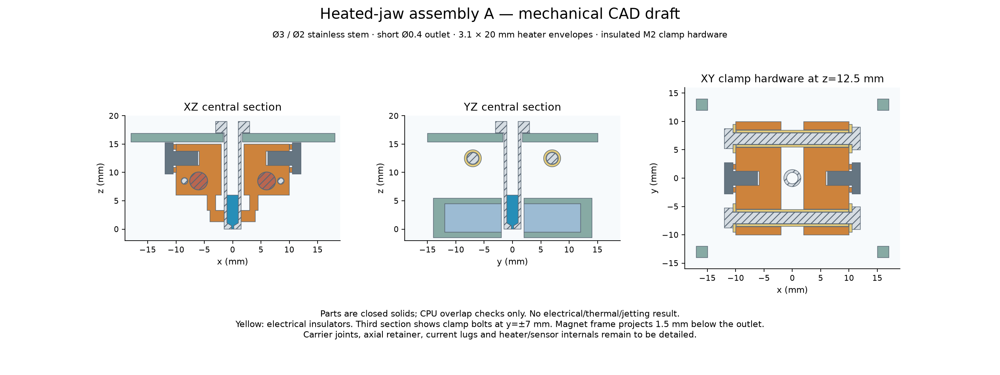

# Heated-jaw assembly A: first mechanical CAD draft

This develops concept A from topic 25 reply 839. It is a 24-body closed-solid CAD draft with CPU overlap checks, not a finished manufacturing assembly or a predicted 100 A jetting result.

1. **Cartridge:** stainless, 3 mm stem OD, 2 mm chamber, 0.4 mm outlet, 0.6 mm internal land, 6 mm initial pool height, 6 mm top collar. The longer round exterior replaces the previous tiny square boss. Chamber and outlet are drilled from opposite ends. A nominal 0.5 mm straight wall is retained; drill runout and stem workholding still require review.
2. **Copper jaws:** two milled blocks with 2.6 mm-wide lower contact toes and half-round seats, contacting the stem over z=1.3–3.3 mm. They include 3.2 mm heater bores for 3.1×20 mm sheath envelopes, 1.2 mm sensor bores, two horizontal insulated M2 clamp bores, and a separate blind M3 tap-drill envelope for each current terminal. Heater and terminal axes are separated; no terminal bolt passes through a heater bore.
3. **Clamp isolation:** two M2 bolt/nut envelopes at y=±7 mm, z=12.5 mm. Each has a nominal ceramic sleeve (3 mm OD / 2.2 mm ID / 19.8 mm long) and two insulating flange washers. Sleeves end short of the outer copper faces, permitting the flange washers to press on the jaws. These dimensions are candidate part envelopes, not verified stock availability or a preload calculation. Actual threads and elastic contact are not meshed.
4. **Surroundings:** two 25×10×5 mm SmCo pole-stack envelopes, common aluminium carrier/frame, and a mica collar washer. The frame stays separate from the copper jaws and locates the collar through insulation. It extends 1.5 mm below the exit. Heater/sensor metal sheaths and ring-lug/screw envelopes are present. Heater internals, sensor wiring, cables and external grounds remain to be represented.
5. **Checks performed:** all 24 CAD bodies are closed and positive-volume; pairwise CPU Boolean intersections above 1e-5 mm³ are zero. The native CPU project loader accepts all 24 bodies. These are geometry checks; no GPU masks or electrical/thermal/fluid calculation was performed for this assembly.
6. **Unresolved before a manufacturing or physics claim:** split the carrier envelope into machinable rails/retainers with actual joints and screw holes; provide the axial cartridge retainer; select sleeve/washer/heater/sensor parts; enlarge the approximately 0.15 mm nominal terminal-head/frame clearance; check installation/tool paths, preload, tolerances and hot movement. The present carrier electrical envelope is useful for layout, but its integral pocket lips are not a resolved magnet installation route.
7. **Next electrical model:** drive the ring terminals at nominal 100 A while retaining finite-resistance copper jaws and all surrounding metal. Measure melt versus steel current/force, contact sensitivity, local heat and actual voltage. A nominal body contact or insulating sleeve in CAD is not a measured contact resistance or insulation qualification. Then address finite heater power and magnet temperatures before one-pulse/repeated-flow tests.

[Loadable inspection project](assembly-inspection.mhd.json), [glTF geometry](assembly.gltf), [CPU checks and unresolved items](mechanical-checks.json). The inspection project uses 0.2 mm preview spacing and disables fluid/thermal evolution; its nominal temperatures/material constants are setup assumptions. Do not promote that preview spacing into a droplet or thin-insulator calculation.

Generate a fresh output directory using `scripts/make_heated_jaw_assembly.py`. It refuses overwriting an existing folder. Initial rejected drafts are retained locally in the research artifacts and were never simulated. A helper-axis error in the first rejected draft and exact-boundary Boolean mesh issues were corrected before the closed-solid draft was exported.
