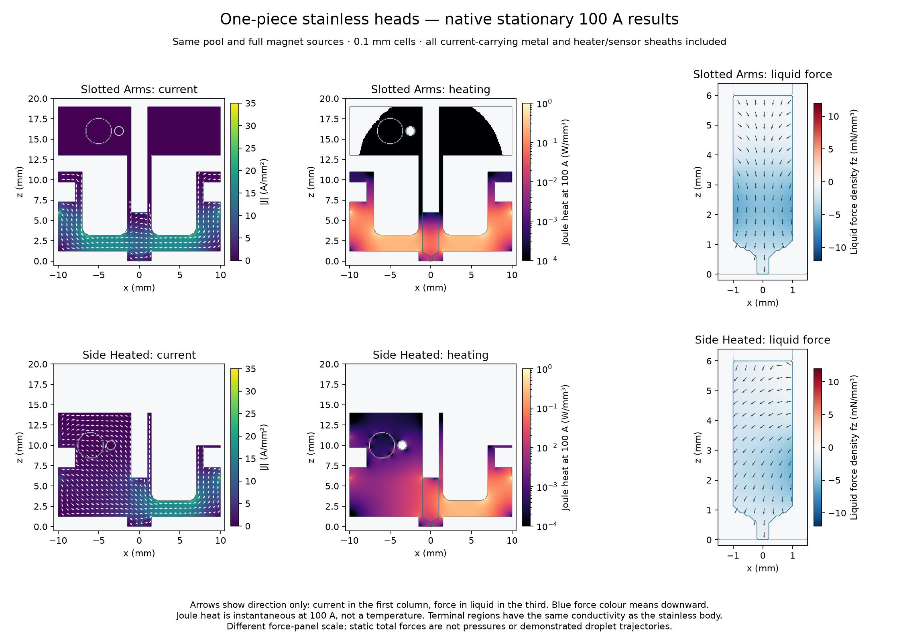
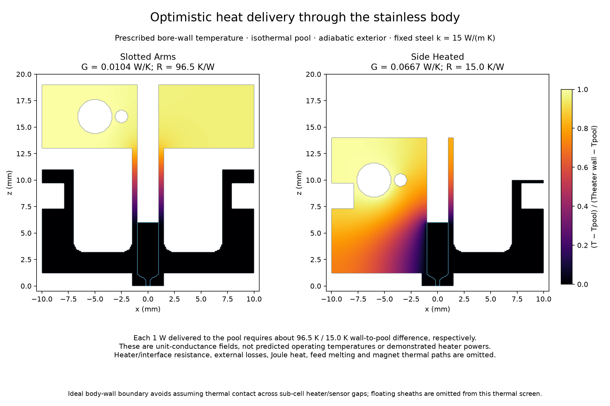

# One-piece stainless: completed initial electrical and heat-delivery screens

At nominal 100 A, both full-body static electrical calculations completed. These are initial one-grid screens, not jetting or full thermal-operation results.

| Quantity | Slotted integral arms | Side-heated bottleneck |
|---|---:|---:|
| Head terminal voltage at 100 A | 0.292 V | 0.177 V |
| Instantaneous Joule power at 100 A | 29.2 W | 17.7 W |
| Liquid current at sampled central x-plane | 71.6 A | 63.4 A |
| Integrated downward liquid force | 46.0 mN | 38.3 mN |
| Integrated lateral liquid force Fx | approximately 0 | −30.8 mN |
| Ideal bore-wall-to-pool conductance | 0.01036 W/K | 0.06670 W/K |
| Corresponding bulk thermal resistance | 96.5 K/W | 15.0 K/W |

1. The integral stainless paths are electrically plausible in this fixed-property screen: the central liquid branch carries substantial current. Current sharing is a cell-centred plane estimate, not a unique fluid through-current; see the native report limitations. Steel still carries an appreciable bypass. The terminal-region material is stainless, with no artificial copper conductivity improvement.
2. The side-heated geometry reduces resistive loss and improves ideal heat delivery by about 6.4×, but its asymmetric current path also creates strong lateral force. Walls may react that force; a tilted droplet cannot be inferred from its integrated value. Moving-fluid behavior remains untested.
3. The overhead heater in the slotted concept has a poor bulk-conduction path. The thermal numbers imply about 96.5 K versus 15.0 K wall-to-pool difference per watt delivered through that path. A hypothetical 5 W load would imply approximately 483 K versus 75 K. Actual feed heat demand is not established by these tests. Interfaces and exterior losses would worsen heat delivery; retained Joule heat and preheated feed could change the operating balance.
4. **Do not interpret the 29/18 W values as average pulse power.** They are instantaneous at static 100 A. Pulse heating requires the actual current dose and evolving resistance; continuous 100 A is a different thermal case.

## Numerical method and scope

1. Both native GPU masks have zero overlap. Current tests use the existing finite-volume GPU operator, strict unit current-balance gate of 10 ppm, requested residual 1e-6 and a 100 ppm energy check. Observed current-boundary defects are about 1.13/5.20 ppm; electrical power defects about −14.9/+1.55 ppm. CPU integration of exported Joule density agrees with native total power to better than 1e-6 relative.
2. The first wider-domain attempt stopped before solving because direct source summation exceeded its work limit. That attempt and outputs remain separate. Compact-domain projects retain every stainless, heater and sensor part, with unchanged cell alignment/spacing and complete external magnet source geometry. Only electrically isolated outer magnet occupancy and surrounding air are cropped; no current-carrying metal is removed. [Actual electrical plan](electrical-plan-v2.json), [results](electrical-results.json).
3. The new `thermal_conductance --integral-pool` mode uses the same GPU scalar finite-volume operator with fixed k. Steel cells in a 1.6–1.75 mm radial band next to the heater bore, over |y|≤5.8 mm, are fixed at +0.5 K; the whole pool is fixed at −0.5 K; other outer surfaces are adiabatic. Steel k is 15 W/(m K). The inherited liquid value 60.5 W/(m K) is an explicit screening input entering the pool boundary half-cell resistance, not a calibrated liquid-alloy law.
4. This deliberately optimistic test omits heater/interface resistance, external losses, wire-feed melting, phase change, transient heat capacity and Joule heat. Heater/sensor sheaths are thermally omitted to avoid implying contact through sub-cell gaps. Earlier V1 thermal outputs retaining those floating envelopes are preserved; the reported V2 values change by less than 6 ppm. Neither is an operating-temperature calculation. [Thermal plan](thermal-plan-v2.json), [results and assumptions](thermal-results.json).
5. GPU uniform-rod checks for k=15/30 and the metal/mica/metal series-resistance check passed. Thermal return/energy checks pass, and exported normalized connected-body temperatures satisfy the [0,1] maximum principle. All screens use one 0.1 mm grid; this is not a droplet-resolution or convergence qualification.
6. Cable lugs, mounting/ground connections, magnet carrier and heater internal electrical insulation remain to be defined before a complete assembly claim. No moving interface, driver voltage transient, self-field, repetitive droplet or continuous stream result is claimed.

## Proposed cuts and machining

Manufacture-first layouts under topic 25 replies 836, 838 and 842. Nominal comparison current is 100 A. These replace the parked copper-jaw concepts, with no copper contact assembly.

1. **1: symmetric slotted arms.** Start from one stainless blank. Keep the upper heater/melt body, two lower side arms, and two 3 mm-thick by 2 mm-high transverse connections to the central nozzle. Mill the windows through Y using a 2 mm end mill; the included R1 roots retain tool radii. The arms end below the heater block, with clearance above them. Drill the chamber axially, microdrill the short outlet from below, drill heater/sensor bores along Y, and tap ordinary cable-terminal holes from X. The lower exterior is a 3 mm-thick plate structure rather than a tiny square boss. The important risk is current bypassing the liquid through the continuous stainless nozzle/body, and limited heater-to-tip conduction.
2. **3: side-heated bottleneck.** Retain a substantial heater body on the left and a single integral lower bridge to the opposite terminal. The open window on the right is milled through Y with R1 roots. The chamber and nozzle are the same, but the heater has a broad direct steel connection to the left of the pool, while the opposite terminal meets the central body only near the intended actuation band. This removes the separate terminal/nozzle contact and shortens the thermal path from heater to pool. It does not electrically isolate the liquid: all remaining steel paths must be calculated.
3. Both retain a 2 mm chamber, 0.4 mm outlet, 0.6 mm internal land, 6 mm initial fill height, the same material assumptions and a 4 mm magnet gap. Both main metal geometries are one connected solid, with zero significant pairwise CPU overlap. The native CPU loader accepts both projects. **Initial static electrical results are above; jetting remains untested.**
4. The glTF divides each continuous metal part into three touching regions solely to mark the positive/negative terminal boundaries. All three have the same stainless electrical/thermal properties. Those are not separate parts, copper pads or contact-resistance joints. Generic native report text calls IDs16/17 copper pads; this study overrides their material properties to stainless, as recorded in the projects. Use the outer X faces for the drive so resistance inside the terminal regions is retained.
5. First compare full-body static current, liquid/steel current sharing, force in the liquid, and local Joule heating at 100 A, then heat delivery with finite heater power/interfaces. Full stainless body, heater/sensor sheath envelopes and magnet geometry are present. Cable lugs/screws, magnet carrier, mounting/ground connections and heater internal insulation remain to be defined before a complete assembly or repetitive operation claim.

## Machining and model limits

1. The windows are open through a 3 mm thickness. Their R1 roots are included. Blind terminal holes are represented as tap-drill envelopes; screw threads, drill-point bottoms, fastener loads, tool deflection and tolerances are not resolved. The heater bore is 3.2 mm for a provisional 3.1×20 mm sheath envelope; exact component fit must be selected.
2. There is no molten-metal seal between assembled nozzle halves. Each liquid cavity is inside one stainless part. Ordinary cable lugs attach to the outside terminals; the nozzles themselves have no fitted copper busbar.
3. The initial pool volumes are matched. Compared with the earlier isolated tip, contact height/current injection geometry and surrounding metal change, intentionally. This is not a claim that only one physical parameter changed.
4. The proposed 0.1 mm grid is for initial electrical screening, not droplet resolution qualification. It provides nominally five cells across the 0.5 mm chamber wall and ten across the window-root radius. Actual voxel overlap/connectivity must pass before solving.

[CAD checks](cad-review.json), [1: loadable model](../designs/integral-slotted-arms-v1/electrical-h0100.mhd.json), [3: loadable model](../designs/integral-side-heated-v1/electrical-h0100.mhd.json). Reproduce with `scripts/make_integral_heads.py` in a checkout with fresh destination directories. Nominal stainless conductivity is the retained fixed hot screening assumption of 1.1 MS/m; this is not a temperature-dependent material law.
