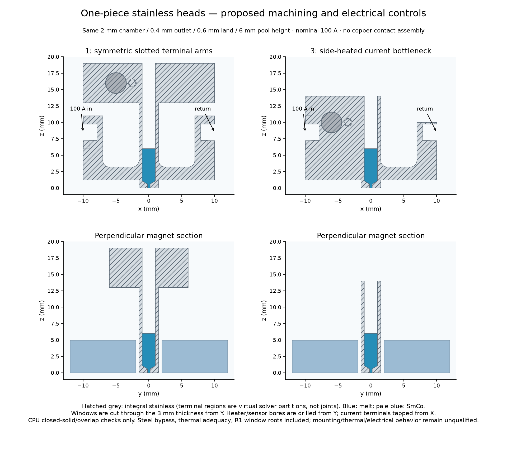

# One-piece stainless concepts: user ideas 1 and 3

Manufacture-first layouts under topic 25 replies 836, 838 and 842. Nominal comparison current is 100 A. These replace the parked copper-jaw concepts, with no copper contact assembly.

1. **1: symmetric slotted arms.** Start from one stainless blank. Keep the upper heater/melt body, two lower side arms, and two 3 mm-thick by 2 mm-high transverse connections to the central nozzle. Mill the windows through Y using a 2 mm end mill; the included R1 roots retain tool radii. The arms end below the heater block, with clearance above them. Drill the chamber axially, microdrill the short outlet from below, drill heater/sensor bores along Y, and tap ordinary cable-terminal holes from X. The lower exterior is a 3 mm-thick plate structure rather than a tiny square boss. The important risk is current bypassing the liquid through the continuous stainless nozzle/body, and limited heater-to-tip conduction.
2. **3: side-heated bottleneck.** Retain a substantial heater body on the left and a single integral lower bridge to the opposite terminal. The open window on the right is milled through Y with R1 roots. The chamber and nozzle are the same, but the heater has a broad direct steel connection to the left of the pool, while the opposite terminal meets the central body only near the intended actuation band. This removes the separate terminal/nozzle contact and shortens the thermal path from heater to pool. It does not electrically isolate the liquid: all remaining steel paths must be calculated.
3. Both retain a 2 mm chamber, 0.4 mm outlet, 0.6 mm internal land, 6 mm initial fill height, the same material assumptions and a 4 mm magnet gap. Both main metal geometries are one connected solid, with zero significant pairwise CPU overlap. The native CPU loader accepts both projects. **No electrical or jetting performance is claimed yet.**
4. The glTF divides each continuous metal part into three touching regions solely to mark the positive/negative terminal boundaries. All three have the same stainless electrical/thermal properties. Those are not separate parts, copper pads or contact-resistance joints. Use the outer X faces for the drive so resistance inside the terminal regions is retained.
5. First compare full-body static current, liquid/steel current sharing, force in the liquid, and local Joule heating at 100 A, then heat delivery with finite heater power/interfaces. Full stainless body, heater/sensor sheath envelopes and magnet geometry are present. Cable lugs/screws, magnet carrier, mounting/ground connections and heater internal insulation remain to be defined before a complete assembly or repetitive operation claim.

## Machining and model limits

1. The windows are open through a 3 mm thickness. Their R1 roots are included. Blind terminal holes are represented as tap-drill envelopes; screw threads, drill-point bottoms, fastener loads, tool deflection and tolerances are not resolved. The heater bore is 3.2 mm for a provisional 3.1×20 mm sheath envelope; exact component fit must be selected.
2. There is no molten-metal seal between assembled nozzle halves. Each liquid cavity is inside one stainless part. Ordinary cable lugs attach to the outside terminals; the nozzles themselves have no fitted copper busbar.
3. The initial pool volumes are matched. Compared with the earlier isolated tip, contact height/current injection geometry and surrounding metal change, intentionally. This is not a claim that only one physical parameter changed.
4. The proposed 0.1 mm grid is for initial electrical screening, not droplet resolution qualification. It provides nominally five cells across the 0.5 mm chamber wall and ten across the window-root radius. Actual voxel overlap/connectivity must pass before solving.

[CAD checks](cad-review.json), [1: loadable model](../designs/integral-slotted-arms-v1/electrical-h0100.mhd.json), [3: loadable model](../designs/integral-side-heated-v1/electrical-h0100.mhd.json). Reproduce with `scripts/make_integral_heads.py` in a checkout with fresh destination directories. Nominal stainless conductivity is the retained fixed hot screening assumption of 1.1 MS/m; this is not a temperature-dependent material law.
