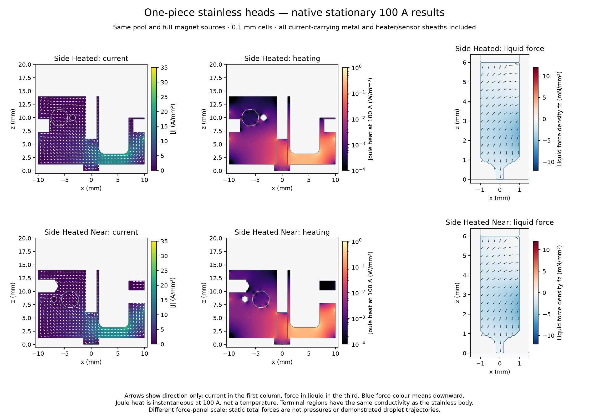
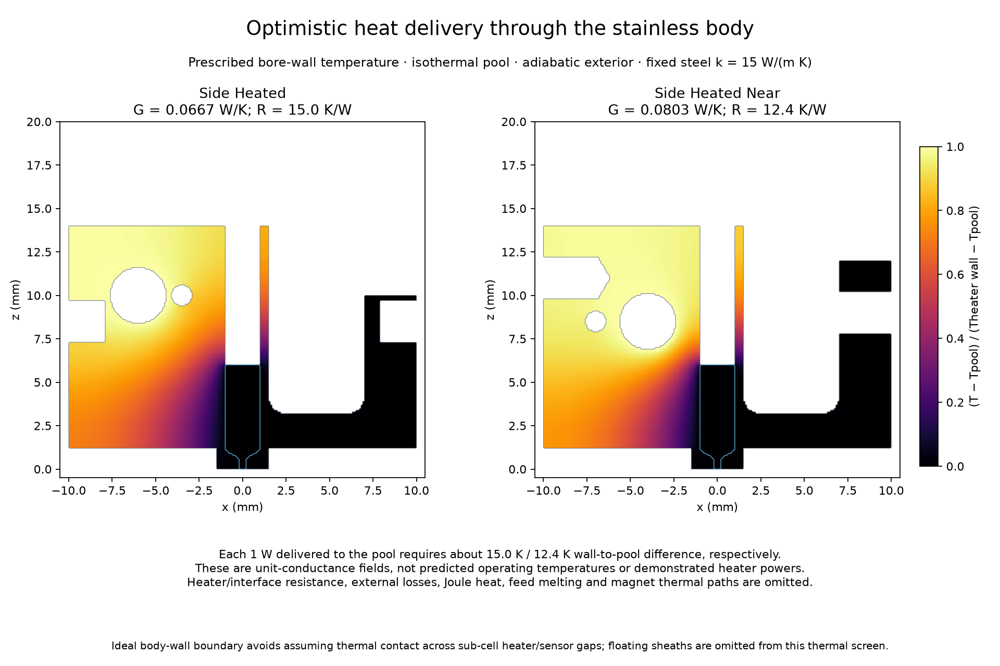
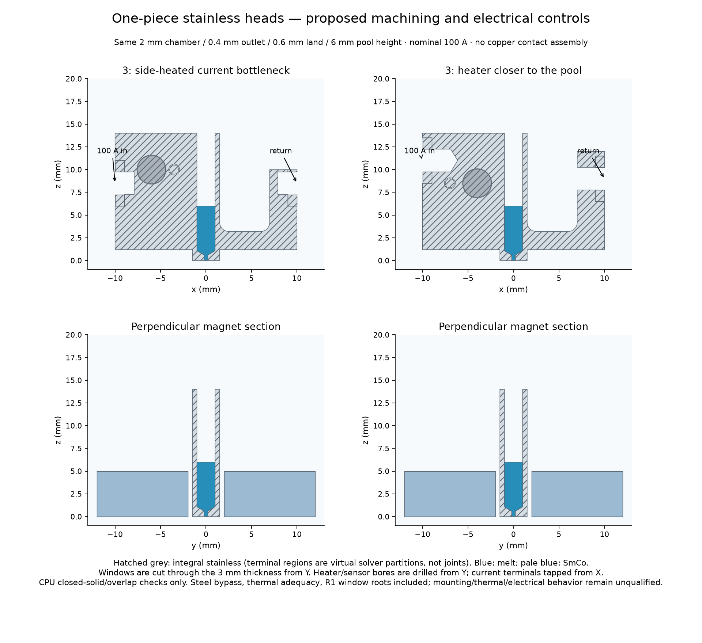

# Nearer-heater revision: completed initial screens

| Quantity at stationary 100 A | Original side-heated | Revised layout |
|---|---:|---:|
| Head voltage | 0.1775 V | 0.1817 V |
| Instantaneous Joule heat | 17.75 W | 18.17 W |
| Sampled centre-plane liquid current | 63.40 A | 63.05 A |
| Downward integrated liquid force | 38.34 mN | 38.15 mN |
| Lateral integrated force magnitude | 30.76 mN | 31.05 mN |
| Optimistic wall-to-pool thermal resistance | 14.99 K/W | 12.45 K/W |

1. Moving the heat source nearer improves ideal conductance by about 20%, or reduces resistance by about 17%. Electrical behavior is similar, with slightly greater resistive loss in the revised machining layout. The asymmetric liquid forcing remains. This is not a jetting result.
2. Both calculations retain the complete current-carrying body and the full prescribed magnet sources. All original screen assumptions and omissions still apply. The thermal result is an ideal body-wall-to-isothermal-pool conductance, not an operating temperature or finite-power/feed calculation.
3. The first revised thermal attempt returned a one-port heat imbalance of 11.405 ppm, exceeding the unchanged 10 ppm acceptance gate. It is preserved as a failed attempt. Re-running only the thermal solve at tighter true-residual tolerance (1e-7 instead of 1e-6), with the same geometry/PDE/boundaries and unchanged gate, passed at about 0.278 ppm heat imbalance. The completed electrical result was reused, not repeated. [Recovery plan](thermal-recovery-plan-v2.json).
4. Both exported normalized thermal fields obey the maximum principle; electrical Joule integration and energy checks pass. Results are from one 0.1 mm grid. No driver transient, moving-fluid, feed, magnet-temperature or repeated-operation qualification is claimed.

[Electrical metrics](electrical-results.json), [thermal metrics](thermal-results.json). The moderate heat-delivery improvement does not remove the stainless bottleneck; next assess broad flat copper plates mounted through mica, without bent fingers or separate heated jaws.

## CAD and machining revision

Manufacture-first revision under topic 25 replies 842/838. The nominal electrical screen remains 100 A. No copper busbars are added.

1. Move the heater centre from x=−6, z=10 mm to x=−4, z=8.5 mm. The 3.2 mm bore retains nominal 0.9 mm steel ligaments to the lower block face and its inner side face. The liquid cavity, 2 mm chamber, 0.4 mm outlet / 0.6 mm land, initial fill, window roots and magnets are unchanged.
2. Move the sensor to x=−7, z=8.5 mm so the heater and sensor bores retain a nominal 0.8 mm separation. Raise the left cable terminal to z=11 mm; a 3.1 mm-deep straight M3 tap-drill envelope and its 118° drill point stay separate from the heater. The right terminal is centred at z=9 mm in a taller 6 mm-high pad, with a through tap-drill hole. These changes provide nominal room around ordinary M3 hardware rather than leaving the earlier shallow blind holes.
3. This is a coupled machining-layout revision, not an isolated heater-position experiment: sensor/terminal holes and the return pad also change. Current sharing, Joule heat and force must be recalculated.
4. CPU checks: one connected stainless part; no significant inter-body overlaps; native project loading passes. The shared generator reproduces both completed original concept geometries byte for byte. [Baseline regression](generator-regression.json). Initial GPU voxelization of this revision has zero overlaps; no physical performance is inferred from that check.
5. Next: full-body 100 A static electrical screening and the same optimistic heater-wall-to-isothermal-pool conductance comparison. The thermal boundary selector now accepts explicit sensor coordinates rather than assuming that it moves with the heater. All previous limits on contacts, losses, finite heater power, feed and magnet temperatures remain.

[Loadable compact project](../../designs/integral-side-heated-near-v1/electrical-h0100-compact.mhd.json), [geometry manifest](../../designs/integral-side-heated-near-v1/manifest.json). Dimensions are nominal CAD, not tolerance/strength qualification. Generate a fresh directory with `scripts/make_integral_heads.py --only side-heated-near --review-root hardware/integral-head-review/near-heater`.
