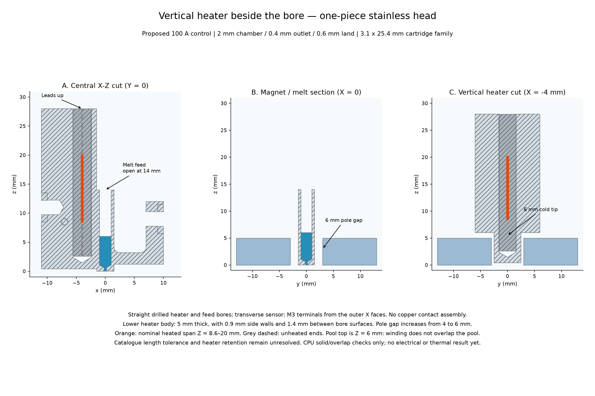
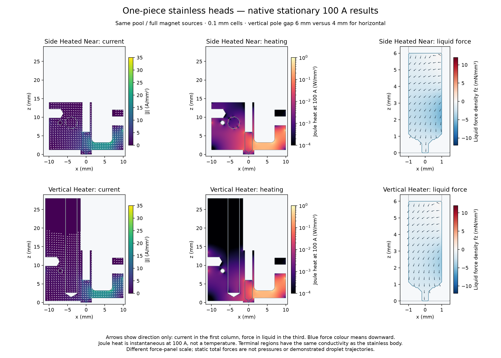
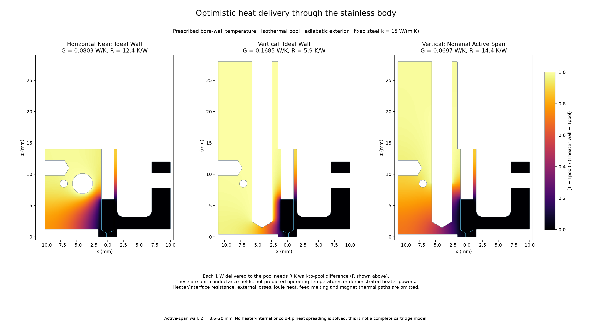

# Vertical cartridge beside the melt bore

The user suggested this layout in topic25 reply848. This is a proposed single-piece stainless body with parallel drilled heater and melt/feed bores, not a qualified assembly.

1. The current-carrying steel is one connected part. The two terminal regions are virtual partitions with the same stainless conductivity. The 2mm chamber, 0.4mm outlet, 0.6mm outlet land and 6mm initial pool level match the prior nearer-horizontal layout.
2. A nominal 3.1 x25.4mm cartridge fits a 3.2mm blind bore at X=-4mm. Leads exit upward. A 118-degree drill point leaves a nominal 1.039mm floor. The bore-to-bore wall is 1.4mm; lower side walls are 0.9mm. The left terminal drill point clears the heater bore by 1.549mm. These are nominal clearances, not a tolerance stack or tool-access qualification.
3. The lower heater body is 5mm thick in Y. The magnet pole gap grows from4 to6mm to leave 0.5mm clearance on each side. The same full25x10x5mm magnet source geometry, magnetization and source quadrature are retained. The electrical screen must include the resulting field loss and changed steel bypass.
4. The body envelope is21x12x28mm, excluding magnets, leads, terminals and mounts. The feed bore is only14mm deep; the adjacent heater tower continues to28mm. The sensor is transverse, avoiding the terminal and heater drill paths. Heater retention, cable connections, carriers, mounting and thermal insulation remain unfinished.
5. The [Hotset HHP 3.1mm family drawing](https://www.hotset.com/wp-content/uploads/2024/09/hotrod-hhp_09_2024_EN_web.pdf) specifies minimum25.4mm length, 6mm unheated tip and8mm unheated lead end. With the sheath at Z=2.6..28mm, the nominal heated span is Z=8.6..20mm, above the pool top at6mm. Length tolerance is substantial (up to±2.4mm in this range); this is a catalogue-family envelope, not a selected or available stock heater.
6. Two thermal controls are prepared. `ideal` prescribes temperature along nearly the whole bore wall; `active-span` prescribes it only beside the nominal winding span. Both use isothermal liquid and adiabatic exterior, omit sheath/contact resistance, finite heater power, internal heater heat spreading, Joule heat, feed demand, mounting and magnet heat balance. They measure ideal bulk-metal conductance only. The active-span control is not a full cartridge model; real cold-end conduction is not solved.
7. The compact computational domain retains all connected steel and the entire pool. Only isolated outer magnet occupancy and the ends of the floating sensor sheath are cropped. All magnet source surfaces remain in the project. No source-resolution reduction is used.
8. CPU solid checks find one connected steel body and no positive-volume inter-body overlaps. The actual project loader passes. GPU voxel-overlap checks also find zero overlaps. Analytic GPU conductance and axis/finite-span selector tests pass. All three native screens completed and passed unchanged current/energy/thermal acceptance gates. All frozen hashes match after completion. Results are below. No fluid run or jetting claim.

Reproduce CAD with `uv run --offline --with manifold3d --with matplotlib --with numpy python scripts/make_vertical_integral_head.py`. It refuses existing geometry directories; `--draw-only` only redraws the saved CAD. The earlier thin-floor CPU draft is preserved under artifacts and was never simulated.

## Completed stationary results

| Measure | Nearer horizontal baseline | Vertical layout |
|---|---:|---:|
| Voltage at100A |0.18175V |0.17549V |
| Instantaneous Joule power |18.1747W |17.5490W |
| Sampled liquid centre-plane current proxy |63.05A |63.86A |
| Total downward liquid force |38.15mN |29.05mN |
| Total lateral liquid force magnitude |31.05mN |17.94mN |
| Ideal whole-wall-to-pool thermal resistance |12.4457K/W |5.9356K/W |
| Vertical nominal winding-span wall-to-pool resistance |Not evaluated |14.3521K/W |

1. Voltage/power change little. Downward force falls about24%, with the steel path and pole-gap/field changes included. This is a whole-layout comparison, not an isolated measurement of magnet-gap sensitivity. The liquid current is a cell-centred plane proxy, not a unique fluid through-current. Force is not pressure or a predicted trajectory.
2. Heating the entire vertical bore wall gives an optimistic2.1x conductance relative to the older horizontal whole-wall control. Restricting the prescribed wall temperature to the nominal winding span reduces the vertical conductance to0.06968W/K. This demonstrates sensitivity to where heat enters the body; it does not establish that a real vertical cartridge is better or worse than a real horizontal one.
3. The active-span control leaves the rest of the bore wall adiabatic. Real internal heat spreading and cold-tip heat delivery are not resolved. A finite cartridge/contact/heat-loss model and actual heater selection are needed before operating-temperature or feed-rate claims. Neither thermal result is a droplet qualification.
4. Native electrical boundary defect5.13ppm and energy defect2.74ppm; thermal heat-return defects0.265ppm (ideal) and1.069ppm (active-span). Maximum-principle range is[0,1] for both thermal fields. CPU integration of exported Joule heat agrees with native power within0.03ppm. Floating sheath cells are excluded using the actual bore axes and finite axial spans.
5. The next useful thermal work is a finite-cartridge heat-spreading/contact sensitivity and a realistic pool heat budget, rather than further small heater-position tweaks. The vertical arrangement remains mechanically attractive, but is not yet a selected head or demonstrated jetting design.

6. Reporting correction: the original native centre-plane proxy used the domain middle, X=-0.45mm for this asymmetric domain. Read-only assessment now integrates the saved field on the actual first nonnegative-X plane (X=+0.05mm), giving63.86A rather than53.79A. Voltage, power, total force and thermal results are unchanged. The native output is preserved and the source reporting bug is fixed for subsequent builds.
