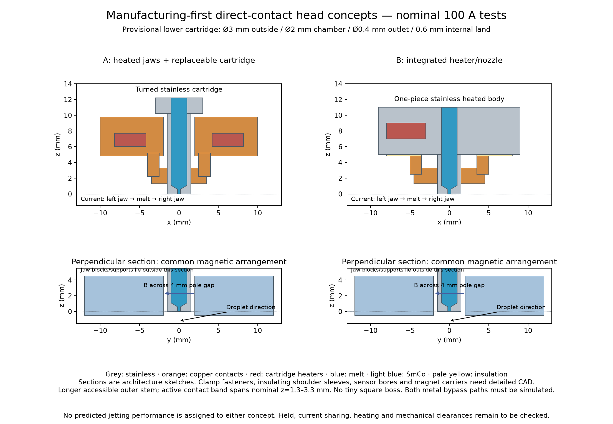

# Manufacturing-first head concepts at nominal 100 A

Requested in topic 25 replies 836/838. These are architecture sketches and proposed experiments, not validated CAD, shop drawings or demonstrated jetting designs. Further reductions in current are secondary to manufacture and assembly.

## A. Turned cartridge with heated copper clamp jaws — first candidate

1. Make one stainless cartridge on a lathe: a round 3 mm outer stem, 2 mm chamber, 118° internal drill taper, and 0.4 mm outlet with a 0.6 mm internal land. Start from rod, drill the chamber to depth, microdrill the outlet, then finish the outer stem with suitable support. Retain a stout top collar for location. The nominal wall along the straight chamber is 0.5 mm; there is no 0.8 mm square boss or milled undercut. Exact tool access, tolerance, runout and workholding remain to be reviewed.
2. Mill two copper blocks with short contact toes and matching half-round seats. Each block carries one miniature cartridge heater, a sensor bore, and a bolted current terminal. Heater axes run along Y above the magnets; the lower contact toes fit inside the pole gap. These are solid machined blocks, not unsupported sheet fingers. Two isolated heater/sensor zones add wiring but put controlled heat directly into the contacts near the pool.
3. Clamp the jaws with bolts through an insulating spacer arrangement; insulating shoulder sleeves prevent bolts from shorting them. The frame supports the top collar and carries magnet attraction independently of the nozzle. Select spacer dimensions, compressive load and hot insulation materials during detailed CAD. The cartridge is replaceable for experiments; it is not a fragile separate outlet foil.
4. Electrical rationale: broad compressed copper/steel contacts should be easier to make reproducible than tiny fingers; the narrow stainless stem limits access to a bulky upper metal bypass. Neither fact establishes the liquid current fraction. Full steel shell, copper jaws, heaters/sheaths, fasteners and intended insulation must enter the electrical/thermal assembly model.
5. Main uncertainties: parallel conduction around the stainless bore and through the solid tip, actual clamped-contact resistance, heat transfer into the melt, and hot dimensional changes. The metal sheath of each heater and any sensor sheath belong to that jaw's electrical environment; verify isolation rather than assuming a shared metal mount or grounded sensor is harmless.

## B. One-piece stainless heater/nozzle body with insulated copper contacts

1. Start with stainless round stock, turn the lower round stem, then mill mounting flats and drill the chamber, outlet, heater and sensor bores. The lower passage matches A initially. The heated body and nozzle are one part, eliminating a threaded thermal joint and its separate heater block.
2. Use two substantial copper clamp contacts on the lower stem. Their mounting lands receive heat from the body through compressed electrical insulation, with insulated fasteners. This avoids separate heaters in both copper jaws and keeps the number of heater circuits low.
3. Electrical rationale: stainless is the intentional body material; copper/aluminium is not allowed to bridge the two contacts directly. A single steel body is simple to machine, but is still a parallel conductor. Model its entire bypass path rather than cropping it from the domain.
4. Main uncertainties: the bulk body may steal more current from the melt, and insulation/contact interfaces may prevent sufficient heat delivery into the jaws and tip. This is the simpler heater arrangement, while A is the more direct way to heat the current contacts. Neither has measured or simulated performance yet.

## Common first experiment and selection

1. Keep a 4 mm magnet face gap and the same assumed SmCo sources initially. Compare the assemblies at a nominal 100 A forward pulse with the existing timing, then measure terminal voltage, current sharing, axial force in liquid versus steel, and local Joule heat. Use the full surrounding assembly. The intended polarity is J along +X and B along −Y, giving force along −Z.
2. Evaluate heat delivery and contact temperature with finite heater power and thermal interfaces, including the magnet carrier/heat paths. A fixed 250°C boundary alone cannot demonstrate heater adequacy or safe magnet temperature. Heater power and contact properties remain design inputs to qualify.
3. Only after these checks, test a single ejection, then pulse trains from the same evolving pool, refill, and sustained flow. A 100 A pulse rating is not a 100 A continuous thermal rating. Continuous drive must be assessed separately.
4. Prefer A for the first detailed CAD because heating and mechanically clamping the contacts are combined in the same robust parts. Retain B as a simpler one-heater alternative. Do not launch another isolated small-chamber/current sweep under the new priorities.

## Component evidence

Miniature heater dimensions are plausible rather than invented parts: [MPI Morheat lists 3.1 mm and 4 mm miniature cartridge diameters](https://mpimorheat.com/heaters/cartridge-heaters/miniature-cartridge-heaters/), and [Hotset documents a 3.1 mm cartridge family](https://www.hotset.com/wp-content/uploads/2024/09/hotrod-hhp_09_2024_EN_web.pdf). Exact voltage, power, hot insulation rating, lead exits, availability and fit remain to be selected. Red blocks in the drawing indicate heater locations, not final heater envelopes. Magnet carrier and clamp fasteners are not yet resolved in these sketches.
