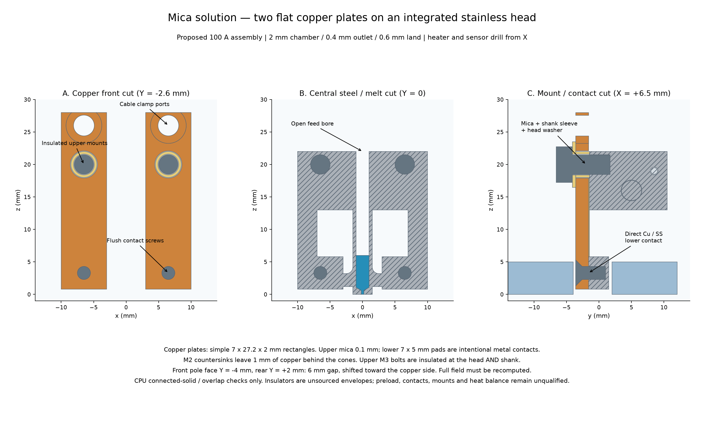

# Flat copper plates on mica

Proposed assembly for user topic25 replies842(option2) and851. This is CPU CAD, not a tested or build-ready head.

1. Two flat7x27.2x2mm copper rectangles carry current from upper cable-clamp ports to broad lower stainless contacts. There are no bent fingers, profiled jaws or access notches in the copper. Two M2 countersunk screws hold the intended lower contacts. The2mm plate leaves1mm behind each nominal90-degree countersink.
2. The steel heater block and nozzle are one connected part. The upper front face is Y=-1.5mm; the lower7x5mm contact pads stand0.1mm proud, at Y=-1.6mm. A0.1mm mica sheet fills that difference above the contact band, electrically insulating the plate from the upper body while providing a thermal path.
3. The upper M3 mounting screws need both shank sleeves and insulating head washers. The drawing includes these envelopes. The shank touches the steel body, while the sleeve and washer prevent contact with copper. Their dimensions are provisional, not sourced stock parts or a validated compression/tolerance stack. A cable lug must connect separately at Z=26mm, above the body, rather than using the insulated mount screw as a terminal.
4. The heater and sensor drill along X, behind the copper. This avoids drilling access openings in either plate. The heater has a nominal3.1x25.4mm family envelope; its unheated ends can protrude from the20mm-wide body while the nominal winding span remains inside. Heater retention, actual cartridge choice and leads are unfinished.
5. Front copper reaches Y=-3.6mm. The front pole face moves to Y=-4mm; the rear stays at+2mm. This gives a6mm gap shifted toward the copper side, rather than symmetrically wasting rear clearance. Full field calculation is required; there is no claimed force or jetting result.
6. CPU Boolean/closed-solid checks pass: one connected steel head and no positive-volume body overlaps. The actual project loader accepts all20 bodies. Thread geometry is represented by non-overlapping nominal envelopes, not teeth. Actual tap drills, engagement and blind-hole cones still need manufacturing drawings.
7. The project includes steel screws, mica sheets/head washers, sleeve envelopes, copper plates and small virtual cable-clamp annuli. The annuli let a future solver apply voltage at the cable ports while retaining the finite copper plate resistance. They are not separate physical parts. Cable lugs/bolts/nuts, magnet carriers and external mounts/grounds remain to be added or bounded.
8. The next screens must retain all body/fastener paths and use material-aware thermal properties. The older integral-head thermal mode hardcodes stainless; it cannot be used unchanged for this assembly. Initial ideal-contact results need Cu/SS electrical and thermal contact-resistance sensitivity. The existing global contact flag applies to liquid/metal interfaces, not Cu/SS, so it cannot substitute for that model.
9. Fixed screening constants in this draft are SS electrical1.1MS/m, Cu25MS/m, Cu thermal394W/(mK), mica0.528W/(mK), sleeve ceramic placeholder25W/(mK). These are declared assumptions, not temperature-dependent hardware qualification. No operating-temperature, heater-power, magnet-temperature, pulse-train or jetting claim.

Reproduce with `uv run --offline --with manifold3d --with numpy --with matplotlib python scripts/make_mica_plate_head.py`. It refuses an existing output directory.
