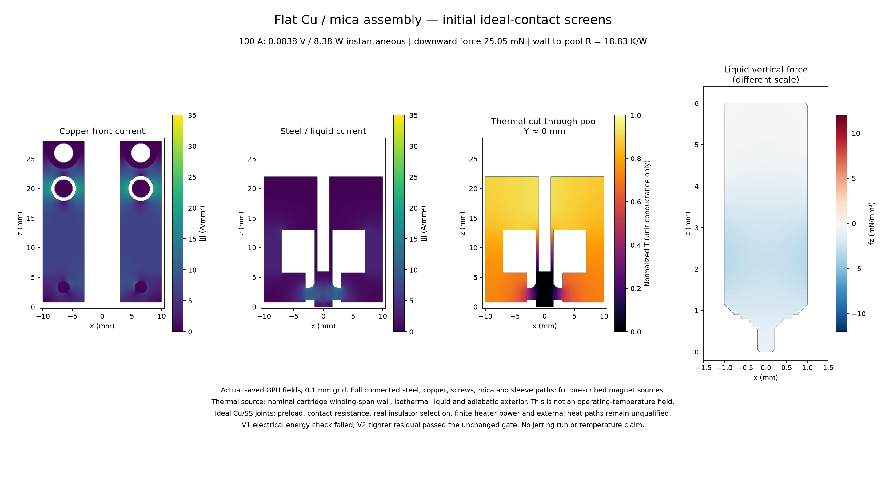

# Flat copper plates on mica

Proposed assembly for user topic25 replies842(option2) and851. This is CPU CAD, not a tested or build-ready head.

1. Two flat7x27.2x2mm copper rectangles carry current from upper cable-clamp ports to broad lower stainless contacts. There are no bent fingers, profiled jaws or access notches in the copper. Two M2 countersunk screws hold the intended lower contacts. The2mm plate leaves1mm behind each nominal90-degree countersink.
2. The steel heater block and nozzle are one connected part. The upper front face is Y=-1.5mm; the lower7x5mm contact pads stand0.1mm proud, at Y=-1.6mm. A0.1mm mica sheet fills that difference above the contact band, electrically insulating the plate from the upper body while providing a thermal path.
3. The upper M3 mounting screws need both shank sleeves and insulating head washers. The drawing includes these envelopes. The shank touches the steel body, while the sleeve and washer prevent contact with copper. Their dimensions are provisional, not sourced stock parts or a validated compression/tolerance stack. A cable lug must connect separately at Z=26mm, above the body, rather than using the insulated mount screw as a terminal.
4. The heater and sensor drill along X, behind the copper. This avoids drilling access openings in either plate. The heater has a nominal3.1x25.4mm family envelope; its unheated ends can protrude from the20mm-wide body while the nominal winding span remains inside. Heater retention, actual cartridge choice and leads are unfinished.
5. Front copper reaches Y=-3.6mm. The front pole face moves to Y=-4mm; the rear stays at+2mm. This gives a6mm gap shifted toward the copper side, rather than symmetrically wasting rear clearance. Full field calculation is required; there is no claimed force or jetting result.
6. CPU Boolean/closed-solid checks pass: one connected steel head and no positive-volume body overlaps. The actual project loader accepts all20 bodies. Thread geometry is represented by non-overlapping nominal envelopes, not teeth. Actual tap drills, engagement and blind-hole cones still need manufacturing drawings.
7. The project includes steel screws, mica sheets/head washers, sleeve envelopes, copper plates and small virtual cable-clamp annuli. The annuli let a future solver apply voltage at the cable ports while retaining the finite copper plate resistance. They are not separate physical parts. Cable lugs/bolts/nuts, magnet carriers and external mounts/grounds remain to be added or bounded.
8. The next screens must retain all body/fastener paths and use material-aware thermal properties. The older integral-head thermal mode hardcodes stainless; it cannot be used unchanged for this assembly. Initial ideal-contact results need Cu/SS electrical and thermal contact-resistance sensitivity. The existing global contact flag applies to liquid/metal interfaces, not Cu/SS, so it cannot substitute for that model.
9. Fixed screening constants in this draft are SS electrical1.1MS/m, Cu25MS/m, Cu thermal394W/(mK), mica0.528W/(mK), sleeve ceramic placeholder25W/(mK). These are declared assumptions, not temperature-dependent hardware qualification. No operating-temperature, heater-power, magnet-temperature, pulse-train or jetting claim.

Reproduce with `uv run --offline --with manifold3d --with numpy --with matplotlib python scripts/make_mica_plate_head.py`. It refuses an existing output directory.

## Initial completed screens

1. The actual GPU voxelization has zero overlaps. All20 bodies are represented. Face-adjacent Cu/SS contacts occur only in the intended lower pad/screw band (Z=0.85..5.75mm), not at the insulated upper mounts. This verifies the discretized separation, not real clamp insulation reliability.
2. At100A, the V2 ideal-contact solve gives0.083806V and8.38068W instantaneous Joule power. About1.53347W is in copper (plates plus small cable-port annuli),6.60858W in stainless including screws, and0.23863W in liquid. Central-plane liquid current proxy is49.56A. Total liquid force is25.049mN down,0.260mN alongY and0.0014mN alongX; these are static totals, not pressure or a droplet trajectory.
3. The material-aware nominal-active-span thermal screen givesG=0.0530933W/K, R=18.8348K/W. This copper/mica arrangement has not demonstrated improved ideal heat delivery to the pool. The central thermal cut shows a substantial gradient in the steel near the pool. Different source/layouts mean this is not a controlled measurement of mica alone.
4. V1 electrical solve met charge balance but its energy defect147.7ppm missed the100ppm gate; it is preserved. V2 changed only the requested residual from1e-6 to1e-7, keeping geometry, PDE, ports, binary and acceptance gates unchanged. V2 energy defect5.48ppm and charge defect0.060ppm pass. The thermal heat-return and energy defects are0.140ppm and0.119ppm; normalized temperature range[0,1]. All frozen hashes match after completion. No long fluid run was started.
5. These initial results still assume ideal Cu/SS electrical and thermal joints. The finite mica and sleeve thermal conductivities are included. Real preload/interface resistance, finite cartridge heat spreading, external loss, feed demand and magnet heat balance are not. No operating-temperature or sustained-jetting claim.
6. Practical hardware lead: the [McMaster ceramic shoulder-washer catalogue](https://www.mcmaster.com/products/ceramic-shoulder-washers/) lists M3 part92107A113 with3.5mm sleeve length,4mm sleeve OD,3.1mm ID,6.2mm flange OD and1.5mm flange thickness. This is a catalogue candidate, not verified NZ availability or an order recommendation. It differs from the provisional CAD sleeve/washer and needs a1.4mm recess into the body for a2mmCu+0.1mmmica stack, plus flange/bolt/tolerance checks. Do not substitute it without updating the CAD.
7. Next work should select practical insulated mounting parts, quantify joint sensitivity, and investigate a broad lower heat/contact route closer to the pool while keeping the copper rectangular. Moving material inward also changes current bypass and must be tested together; it is not assumed to improve jetting.

