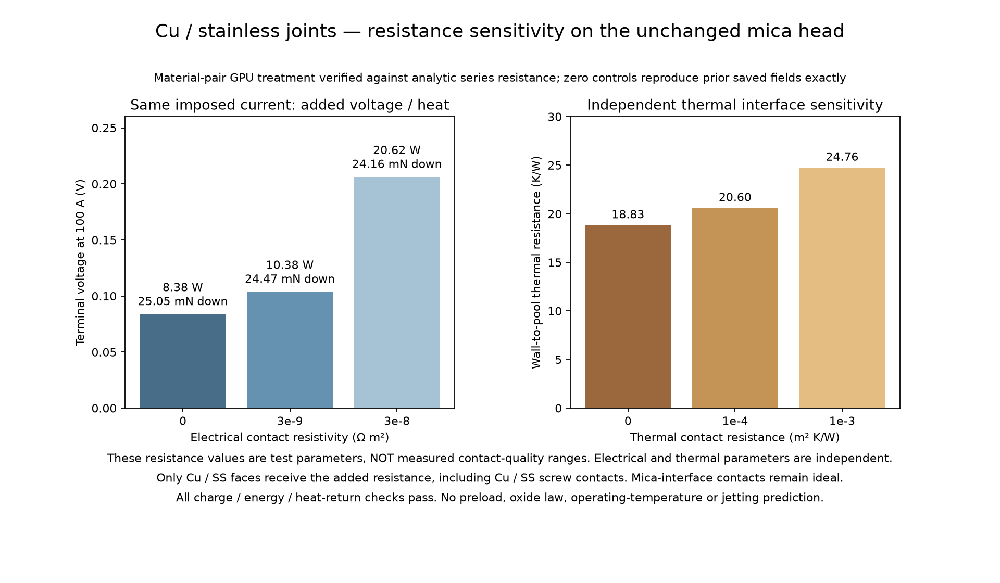

# Cu/SS contact sensitivity on the unchanged first mica assembly

1. The research finite-volume operator now supports an added area-specific resistance between one named material-group pair. The harmonic half-cell resistances remain, with the contact resistance in series at the face. The same coefficient is used for charge, flux and dissipated power. The thermal analogy uses the same interface law with m²K/W units.
2. Material tags occupy unused low16 mantissa bits of the existing discrete cell flag word; flags are decoded explicitly. This adds no GPU storage buffer, per-cell GPU memory or binding. Untagged callers retain the original cell bytes. The solver version is`conservative-split-f32-pair-interface-v3`.
3. A GPU analytic series test verifies electrical and thermal dimensional scaling, reversed pair order, selective treatment with identical conductivity in all groups, the potential jump, unaffected third-group interface, zero resistance and missing-tag rejection. All9 conduction tests and existing thermal analytic checks pass.
4. Six native cases completed at unchanged geometry: electrical resistivity0,3e-9,3e-8Ωm²; independent thermal resistance0,1e-4,1e-3m²K/W. These are sensitivity parameters, NOT measured Cu/SS hot-joint ranges. They are not correlated through a preload/oxide law.
5. The zero electrical case reproduces every saved field word and material mask exactly. The zero thermal case reproduces every saved potential word exactly. Thus the new treatment has no changed zero-contact baseline. All current/energy/heat-return gates pass; frozen hashes match at assessment.
6. At100A, voltage rises0.083806→0.103776→0.206204V; total instantaneous heating8.3807→10.3777→20.6208W. Downward force changes25.049→24.471→24.161mN. These totals include bulk-current redistribution; the power increase is not exclusively joint heating.
7. Wall-to-pool thermal resistance rises18.8348→20.5963→24.7586K/W. Only Cu/SS faces receive the added resistance, including Cu/SS screw contacts. Mica/Cu and mica/SS interface contact resistance is still omitted, though finite mica bulk conductivity is included. No operating-temperature, pulse-train or jetting result.
8. The stock-mount CAD revision and Geoffrey's subsequentConcept1.blend are separate layouts and have not inherited these results.

