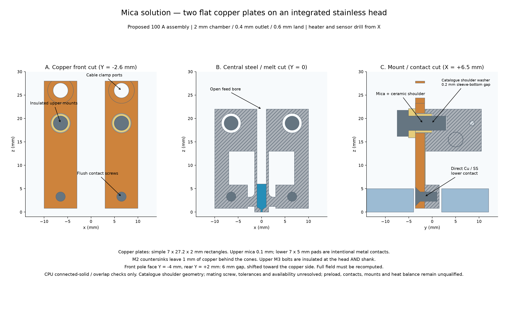

# Catalogue shoulder-washer fit study (CPU only)

1. The [McMaster ceramic sleeve-washer catalogue](https://www.mcmaster.com/products/ceramic-shoulder-washers/) lists M3 candidate92107A113: sleeve3.5mm long/4mmOD/3.1mmID, flange6.2mmOD/1.5mm thick. This is a catalogue geometry candidate, not confirmed NZ availability, ceramic composition, thermal conductivity, torque or tolerances.
2. For a2mmCu+0.1mmmica stack, the body has a1.6mm recess below its front face. The nominal sleeve end clears the recess floor by0.2mm, so the sleeve need not bottom out before the flange clamps copper. Actual tolerances, mica compression and thermal expansion still need checking.
3. The upper mount is lowered fromZ20to19mm to leave0.9mm above the4.2mm counterbore. The heater moves down0.5mm toZ15.5, leaving0.9mm below its3.2mm bore and a conservative0.882mm nominal bore-to-thread-envelope separation. M3x8 gives nominal2.8mm engagement beyond the recess; the pan-head envelope is provisional. Actual tap drills/cones/thread engagement remain to be drawn.
4. The original CPU draft's counterbore broke out of the upper face; that draft was never simulated and is parked under artifacts. The corrected geometry is`hardware/designs/mica-stock-mount-v2`. The default generator reproduces the first mica body'sglTF/bin byte-for-byte.
5. CPU checks: one connected steel body, no positive-volume overlaps, actual project loader accepts20 bodies. The ceramic stem/flange are two touching virtual regions of one physical shoulder washer. No GPU voxelization or stationary/thermal/fluid tests have been run on this revision. It is parked while reviewing the user'sConcept1.blend.

