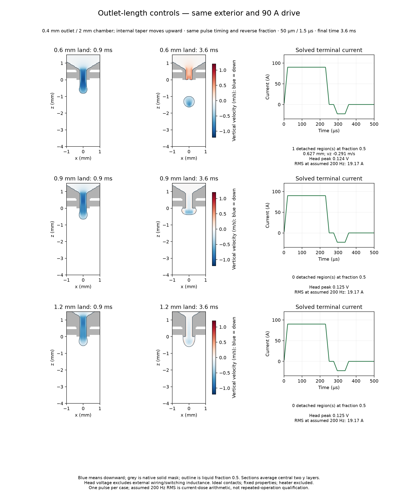

# Outlet-length results and preparation

**Completed comparison:** at 90 A, the 0.6 mm land produces one detached region at all four thresholds by 3.6 ms; both the 0.9 and 1.2 mm lands produce none at any checked threshold. The longer internal passage has not improved lower-current ejection in this comparison. All runs completed 2400 steps; the 1.2 mm case has a 0.1252 V head peak, volume drift below 9.3e-9 relative and electrical energy-identity defect about 21.4 ppm. No saved liquid reaches a domain boundary.



The 0.9 mm case reaches 0.125 V head peak, with the same 19.17 A RMS current dose at assumed 200 Hz. Maximum relative liquid-volume drift is 1.06e-8, no saved boundary contact, and electrical energy-identity defect is about 20.9 ppm. These are one-grid, single-pulse results with fixed properties and ideal contacts; no repeated operation, calibrated wetting or thermal qualification. [Actual native metrics](results.json).

## Geometry preparation


Prepared under topic 25 reply 824 while the lower-current sequence runs. These are CPU CAD checks, with no new GPU geometry check or fluid result.


1. Compare 0.6, 0.9 and 1.2 mm lengths of the existing 0.4 mm outlet. The 2 mm chamber, 118 degree taper angle, 6 mm initial fill height, outside shape, contacts and magnets stay fixed. The taper moves upward, decreasing liquid volume from 16.143 to 15.238 and 14.334 mm³. This coupled volume change is inherent to keeping the outer envelope fixed.
2. A longer narrow passage increases hydraulic resistance and fluid inertia, and changes current distribution. It is a control to measure, not an assumed improvement in jetting.
3. CPU checks confirm the combined steel/liquid envelope is unchanged to Boolean precision, no significant steel/liquid overlap, and identical triangle payloads for all other bodies. The default 0.6 mm glTF and binary are byte-identical to the source of the completed corrected 2 mm case. [Checks](cad-review.json).
4. The full hot-contact fixtures and copied completed flow settings are now prepared and CPU-loader validated: [0.9 mm](../designs/plain-outlet-land-090/flow-h0050.mhd.json), [1.2 mm](../designs/plain-outlet-land-120/flow-h0050.mhd.json). All other body position payloads match the completed baseline; settings differ only in geometry and triangle counts. [Preparation checks](project-preparation.json). Before long runs, validate actual GPU masks and overlaps, and freeze fresh project/geometry hashes. The currently active current-amplitude sequence is untouched. Choose test current from its measured outcomes.

Reproduce source geometry with `scripts/make_stub_m6_cases.py`, output `artifacts/hardware-research/cases/plain-land-cpu-v1-060`, `-090`, or `-120`, and these shared options:

```text
--only stub4 --pole-gap-mm 4 --heater-clearance-mm 1
--lower-drill-half-angle-deg 59 --boss-width-mm .8
--tip-root-radius-mm .1 --contact-height-mm .35
--chamber-bore-mm 2 --neck-flat-halfwidth-mm 1.7
--preserve-boolean-mesh --outlet-land-mm 0.6
```

Use 0.9/1.2 for the other candidates. Then run `scripts/prepare_outlet_land_review.py` with manifold3d, numpy and matplotlib available. Source output directories must be fresh; the generator refuses overwriting.

Full fixtures use `scripts/make_hot_contact_case.py` with the corresponding `plain-land-cpu-v1-090/stub4` or `-120/stub4` source and `--anchor-width-mm 10`; `scripts/prepare_outlet_land_projects.py` copies and checks the flow settings. The CPU loader reports fluid/thermal disabled in the base project because the dedicated conduction-flow executable configures its experiment at runtime, as for the completed baseline.

**GPU initial checks completed:** both new lengths have zero overlapping cells. Relative to the corrected 0.6 mm baseline, all mask changes are liquid-to-steel within the raised internal passage/taper: 7,272 and 14,544 cells respectively. All other body masks are identical. [Native initial-grid checks](gpu-initial-checks.json). These establish valid voxel inputs, not jetting performance. The next pulse comparison uses 90 A, which ejected in the completed 0.6 mm case.

Assess the completed native land cases with `scripts/assess_plain_current_sweep.py --study land`. It uses the 90 A / 0.6 mm completed control and requires both new runs to finish by default; `--available` explicitly labels missing cases. Outputs stay in this directory, separate from the current-amplitude record. Verify the rendered three-row figure before publishing.

Under the updated manufacture-first priorities in topic 25 replies 836/838, this control study is closed. No further isolated chamber/current optimization is queued. Next work is the complete heated assembly, at nominal 100 A. A longer accessible external stem is distinct from the longer internal restriction tested here.
