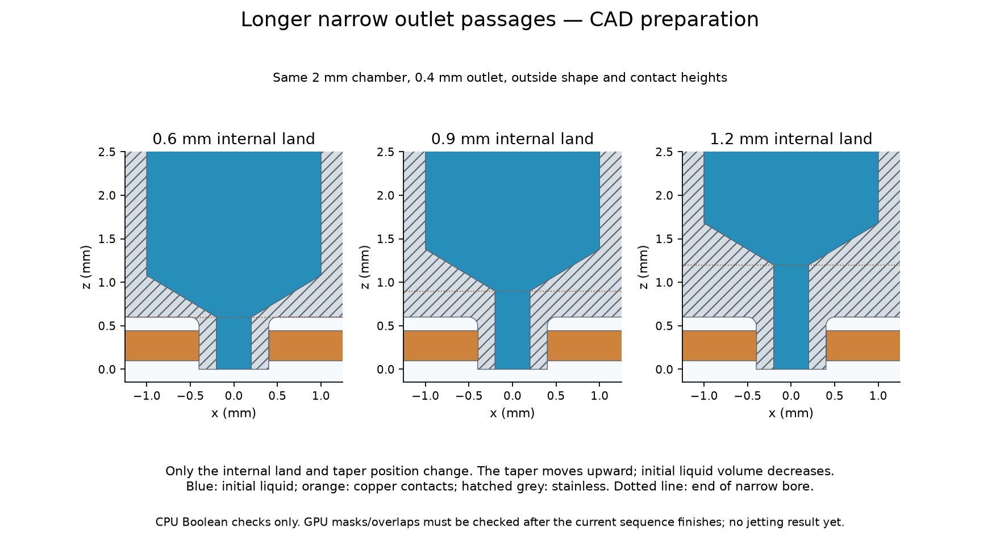

# Internal outlet-length controls

Prepared under topic 25 reply 824 while the lower-current sequence runs. These are CPU CAD checks, with no new GPU geometry check or fluid result.



1. Compare 0.6, 0.9 and 1.2 mm lengths of the existing 0.4 mm outlet. The 2 mm chamber, 118 degree taper angle, 6 mm initial fill height, outside shape, contacts and magnets stay fixed. The taper moves upward, decreasing liquid volume from 16.143 to 15.238 and 14.334 mm³. This coupled volume change is inherent to keeping the outer envelope fixed.
2. A longer narrow passage increases hydraulic resistance and fluid inertia, and changes current distribution. It is a control to measure, not an assumed improvement in jetting.
3. CPU checks confirm the combined steel/liquid envelope is unchanged to Boolean precision, no significant steel/liquid overlap, and identical triangle payloads for all other bodies. The default 0.6 mm glTF and binary are byte-identical to the source of the completed corrected 2 mm case. [Checks](cad-review.json).
4. Before long runs, create the full hot-contact fixtures, copy the completed flow settings, validate actual GPU masks and overlaps, and freeze fresh project/geometry hashes. The currently active current-amplitude sequence is untouched. Choose test current from its measured outcomes.

Reproduce source geometry with `scripts/make_stub_m6_cases.py`, output `artifacts/hardware-research/cases/plain-land-cpu-v1-060`, `-090`, or `-120`, and these shared options:

```text
--only stub4 --pole-gap-mm 4 --heater-clearance-mm 1
--lower-drill-half-angle-deg 59 --boss-width-mm .8
--tip-root-radius-mm .1 --contact-height-mm .35
--chamber-bore-mm 2 --neck-flat-halfwidth-mm 1.7
--preserve-boolean-mesh --outlet-land-mm 0.6
```

Use 0.9/1.2 for the other candidates. Then run `scripts/prepare_outlet_land_review.py` with manifold3d, numpy and matplotlib available. Source output directories must be fresh; the generator refuses overwriting.
