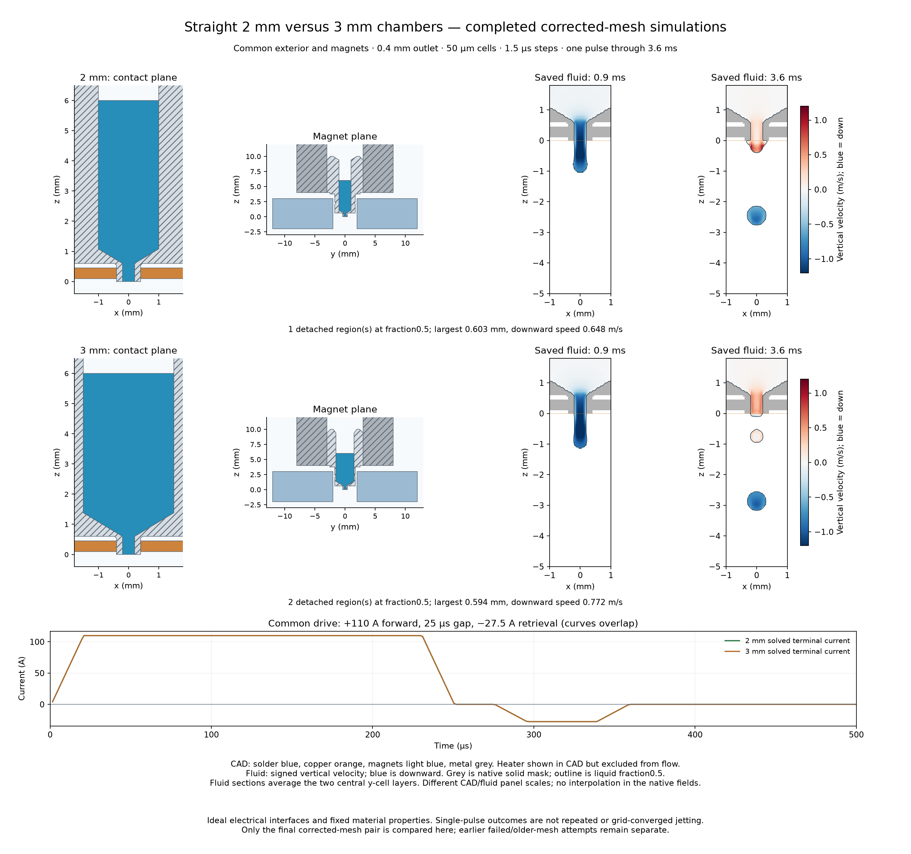
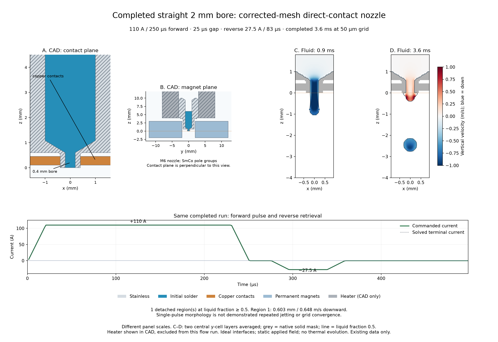
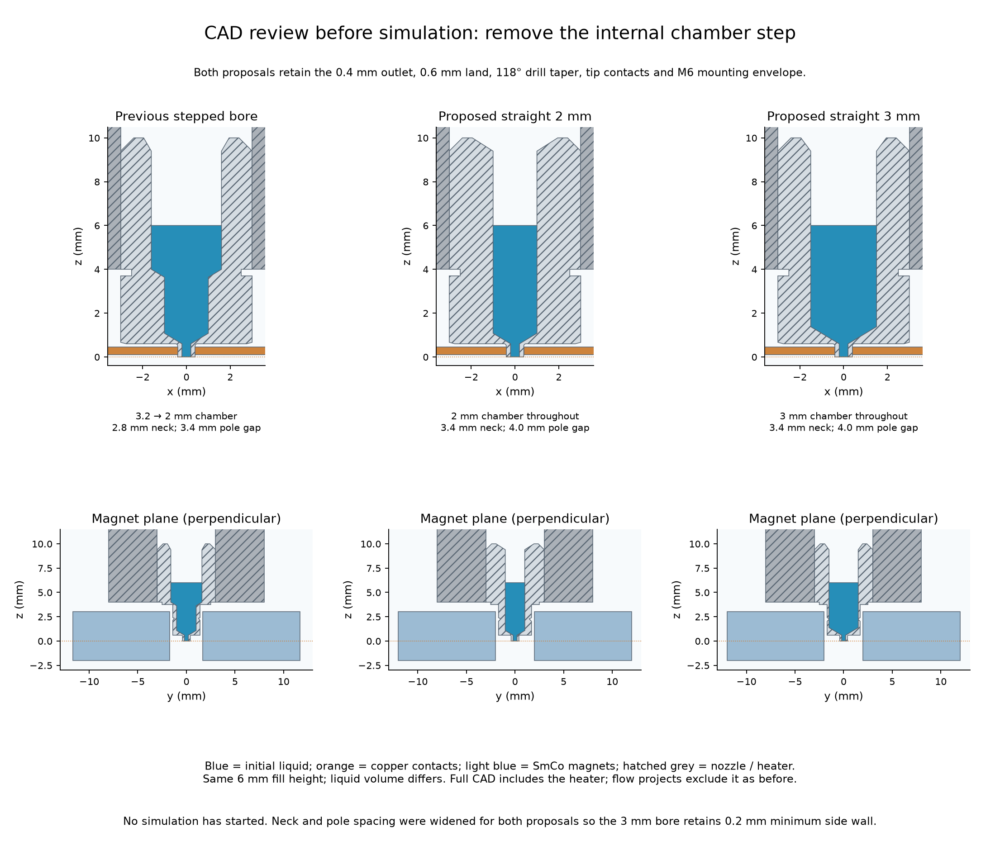

# Completed straight-bore comparison

Both corrected-mesh cases completed 2400 steps / 3.6 ms. Earlier attempts and repairs are recorded below; they are not included in this final pair.

1. **2 mm bore:** one detached region at all four liquid-fraction thresholds. At fraction 0.5: diameter 0.6035 mm, downward speed 0.6477 m/s.
2. **3 mm bore:** two detached regions at all four thresholds. The leading region is 0.5936 mm at 0.7720 m/s downward; the second is 0.4177 mm at 0.1421 m/s upward. This is less clean than the 2 mm result.
3. Both use the same 110 A forward / 27.5 A reverse pulse. Head-voltage peaks are approximately 0.152 V, excluding external wiring and switching inductance. Current-dose RMS at an assumed 200 Hz is 23.43 A; repeated operation is not simulated.
4. No saved liquid reaches the domain boundary. Maximum relative volume drift is about 1.1e-8; electrical energy-identity defects are about 17.7 ppm. These diagnostics do not establish convergence or experimental accuracy.
5. Select the 2 mm design for the lower-current follow-on authorized by reply 824. Fixed properties, ideal contacts, imposed permanent field, excluded heater block and uncalibrated wall behavior remain limits. [Machine-readable results](results.json), [follow-on plan](overnight-plan.md).

## Earlier CAD review and execution history

Requested in topic 25, replies 797–801. The CAD was shown and reviewed before launch; both custom-part simulations were subsequently approved in reply 805. The figure below records the pre-launch review.

**Update, reply 805:** the user accepted these as custom parts and authorized both runs after the CAD review. The fixed two-case sequence was launched headlessly on NVIDIA, using the unchanged executable from the completed fine-grid reference. [Commands and scope](simulation-plan.json). Live state is preserved locally in `artifacts/hardware-research/plain-bore-v1-state.json`; this approval does not resume the wider research campaign.

**Execution interruption:** the initial 2 mm attempt stopped after its last logged step 380 (570 µs), without a terminal result or native error message. Both solver and controller processes were gone when checked, and the tool session was unavailable. The exact termination cause is unknown. Those partial outputs are preserved; they are not a completed result. The GPU preflight remained healthy and all frozen input/binary hashes matched. The same pair was restarted with fresh `plain-bore-v2` outputs under a detached controller, so it does not depend on a long-lived command-tool session. [Unchanged physical commands with new output paths](simulation-plan-recovery-v2.json). Current live state: `artifacts/hardware-research/plain-bore-v2-state.json`. No additional candidate or changed numerical setting is included.

**V2 numerical failure and V3 recovery:** the detached 2 mm attempt reached 2.6625 ms, then failed the boundary-current gate after 4,000 iterations (true residual 1.625×10⁻⁷, relative boundary defect 3.146×10⁻⁵). The 3 mm case had not started. This is distinct from the earlier process interruption; resource logging showed no OOM kill or memory pressure. The old executable had deliberately matched the historical fine reference, but retained known potential-splitting and near-zero-current limitations. Both requested cases now use the previously validated `conduction_flow_current_tolerance` executable: the higher-precision potential split, unchanged local residual and strict 10 ppm unit-basis gates, plus an explicit 1 µA absolute allowance only for the motional basis. Geometry, physical model, waveform, grid and timestep are unchanged. The exact failed basis was not identified by the old error output, so the diagnosis remains a matching failure signature, not a confirmed mode identification. [Failure and prior validation](numerical-recovery.json), [V3 commands](simulation-plan-numerical-v3.json). Current state is `artifacts/hardware-research/plain-bore-v3-state.json`. Earlier outputs remain separate and failed; neither is relabelled complete.

**V3 2 mm completion, then mesh repair:** the 2 mm run completed 3.6 ms with one detached region at all reported thresholds (0.603 mm / 0.658 m/s down at threshold 0.5). The 3 mm run was rejected before timestepping by 12 steel/liquid overlap cells. A dedicated initial-grid diagnostic localized them; bypassing the optional Boolean-mesh simplification removed the overlaps. It also restored approximately 1.06 mm³ of steel in both nozzle exteriors, so simply using the completed older 2 mm result against the repaired 3 mm would confound the comparison. The earlier completed result remains valid for its actual mesh and is preserved, but is not the final matched pair.

**Current V4 sequence:** both nominal designs were rebuilt with `--preserve-boolean-mesh`, and both initial GPU masks have zero overlap. The masks share their exterior and other-body assignments. Bore enlargement produces the expected steel-to-air/liquid changes, plus eight local classification differences on the common nominal outlet taper (1 nL total), retained as a triangulation/rasterization limitation. [Grid-mask checks and exact counts](mesh-repair.json). Both corrected cases use the same repaired solver, waveform, grid and timestep as V3; no nominal design parameter changed. [V4 commands](simulation-plan-mesh-v4.json); live state `artifacts/hardware-research/plain-bore-v4-state.json`.

The rejected direct-cavity and shared-surface diagnostic meshes are parked under `artifacts/hardware-research/cases/plain-bore-invalid-mesh-diagnostics` and marked invalid. They are not simulation candidates. `examples/inspect_overlap.rs` performs initial voxelization and reports conflicting body masks without time integration.

## Completed corrected 2 mm case

The V4 2 mm run completes 2,400 accepted steps / 3.6 ms. Its final export has one detached region at all four reported liquid-fraction thresholds. At threshold 0.5 the diameter is 0.60348 mm and downward speed 0.64766 m/s. This is one simulated pulse, not a repeated-jetting qualification. The 3 mm case was still running when this individual summary was posted. [Recorded metrics](2mm-summary.json).

Reproduce the image with `scripts/plot_direct_selected_run.py --run artifacts/hardware-research/plain-bore-v4-2mm-flow110-r25-h0050 --output hardware/plain-bore-review/2mm-summary.png --label 'Completed straight 2 mm bore: corrected-mesh direct-contact nozzle'` under the same headless Python environment as the other plots.

**Manufacturing correction, reply 804:** these drafts are custom M6-compatible shapes, not subtractive conversions verified against a stock V6 solid. Their 10 mm body and stockier lower nose differ from a standard 12.5 mm V6. Closed meshes and absence of overlaps do not establish stock containment. The authorized simulations must not be described as stock-V6 conversion tests. A subtractive-only revision would have to preserve the stock mounting and outlet, start from the correct smaller-bore variant, and check all proposed cuts and remaining walls. An existing 3.2 mm bore cannot be reduced to 2 or 3 mm by cutting.

1. Previous reference: a 3.2-to-2 mm internal shoulder, 2.8 mm neck width and 3.4 mm magnet pole gap. The shoulder was introduced in our custom model; it is not in the user's standard-nozzle drawing.
2. Proposed pair: straight **2 mm** and **3 mm** chambers, both with the same **3.4 mm neck width and 4.0 mm pole gap**. The wider common neck leaves 0.2 mm minimum side wall around the 3 mm chamber. Both retain 0.3 mm clearance from each magnet face to the neck.
3. Common features: M6 mounting envelope, 0.4 mm outlet, 0.6 mm outlet land, 118° lower drill taper, 0.8 mm square tip boss with R0.1 root, copper contacts, SmCo source settings, materials, 6 mm initial fill height, 50 µm grid, gravity, domain and electrical boundary conditions. No feed wire. The heater is shown in CAD but excluded from flow, matching the earlier experiment.
4. Proposed waveform: +110 A / 250 µs forward, 25 µs gap, reverse 27.5 A / 83.33 µs, uniform 1.5 µs time steps through 3.6 ms. This is a proposal copied from the completed reference, not a performance result for either new geometry.
5. Same fill height does not mean equal liquid volume. Bore diameter also changes the length of the 118° outlet taper. These are inherent effects of this diameter comparison. Since both cases use a wider exterior and magnet gap, comparisons to the historical narrow-neck result would not isolate bore diameter alone.
6. Checks completed: both cases have closed solids with positive volume and no generator-detected overlaps; the native CAD importer reports closed bodies. All mesh position payloads after the nozzle/liquid bodies are byte-identical between the two proposed cases. Effective flow settings are identical except geometry and the nozzle/liquid triangle counts. These are geometry/input checks, not GPU tests.

Loadable projects and geometry: [2 mm](../designs/plain-bore-2mm/flow-h0050.mhd.json), [3 mm](../designs/plain-bore-3mm/flow-h0050.mhd.json). The dedicated conduction-flow experiment uses the prescribed terminal pulse; opening a project in the GUI does not reproduce those electrode boundary conditions by itself.

The comparison preparation script is `scripts/prepare_plain_bore_review.py`. CAD is generated using `scripts/make_stub_m6_cases.py` with `--chamber-bore-mm 2` or `3`, `--neck-flat-halfwidth-mm 1.7`, `--pole-gap-mm 4`, `--heater-clearance-mm 1`, `--lower-drill-half-angle-deg 59`, `--boss-width-mm .8`, `--tip-root-radius-mm .1` and `--contact-height-mm .35`; `scripts/make_hot_contact_case.py` adds the shared contacts/heater fixture with anchor width 10 mm. Generated source cases are preserved under `artifacts/hardware-research/cases/plain-bore-v1-{2,3}mm-source`.
