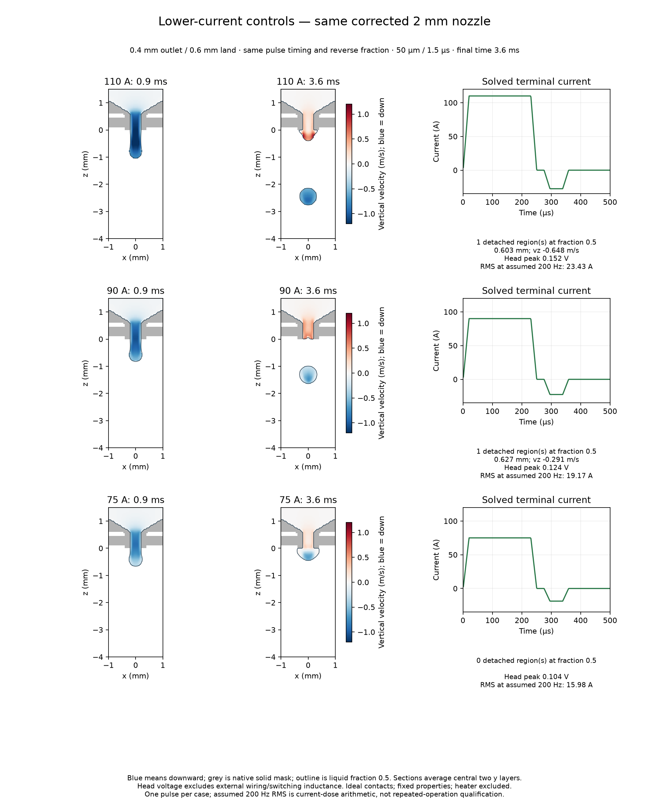

# Lower-current controls on the corrected 2 mm nozzle

Current sweep authorized by topic 25 reply 824. Geometry, pulse timing, reverse fraction, 50 µm grid and 1.5 µs timestep are fixed; only current amplitude changes.

1. **110 A baseline:** one detached region at all four thresholds; 0.603 mm equivalent diameter and 0.648 m/s downward at fraction 0.5.
2. **90 A completed:** one detached region at all four thresholds; 0.627 mm and 0.291 m/s downward. Head voltage peaks at 0.124 V; current-dose RMS at assumed 200 Hz is 19.17 A. It ejects a larger, slower region rather than scaling drop size linearly with current. Volume drift stays below 4.2e-9 relative; no saved boundary contact. Electrical energy-identity defect is about 19.7 ppm.
3. **75 A completed:** no detached region at any of the four checked thresholds at 3.6 ms. Head peak 0.1036 V; RMS at assumed 200 Hz 15.98 A. This bounds ejection for the tested pulse and observation window between the observed 75 A non-ejection and 90 A ejection; it is not a universal threshold. Maximum relative volume drift is below 8.7e-9, no saved boundary contact, and energy-identity defect is about 20.4 ppm.
4. Next compare 0.9/1.2 mm outlet lands at 90 A against the completed 0.6 mm case. That current already ejects, so the geometry effects can be assessed at the lower successful amplitude.
5. These are exploratory single pulses with ideal electrical contacts, fixed properties and a static imposed magnet field. Heater block, current self-field, calibrated wall wetting, oxides, feeding and repeated thermal operation are not qualified. The 90 A result exceeds the nominal 0.6 mm size target at the stated threshold.

[Detailed metrics](results.json). Run `scripts/assess_plain_current_sweep.py` after all three cases complete, or `--available` to produce an explicitly partial report. The script requires 2400 accepted steps/current rows and matching non-amplitude run settings, and reads the actual saved native fields.
