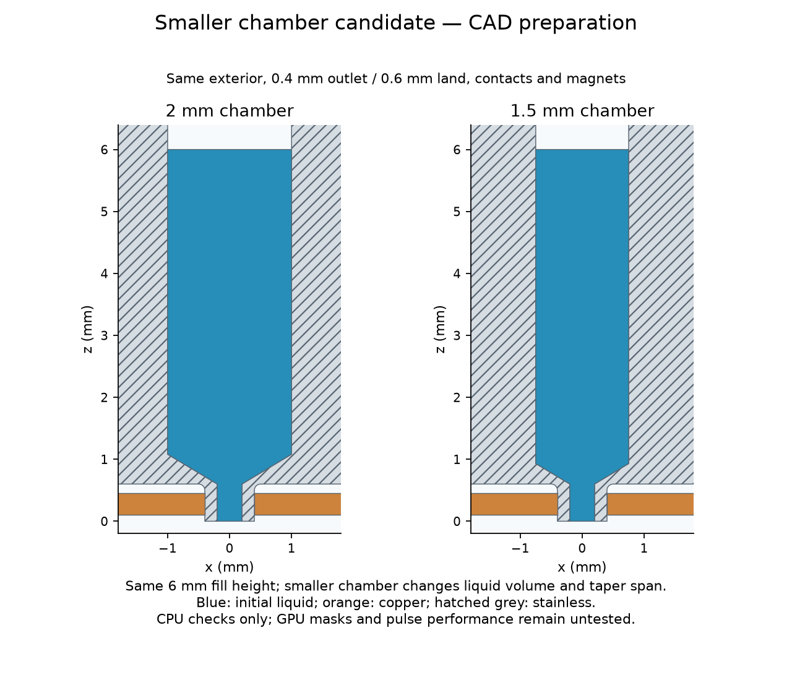

# Smaller chamber candidate

CPU preparation under topic 25 reply 824. No GPU mask check or flow run has started. Select the next experiment after the active 1.2 mm outlet-land control finishes.

1. Reduce the straight chamber from 2 to 1.5 mm while retaining the 0.4 mm outlet, 0.6 mm land, exterior, contact positions and magnets. The initial fill height stays 6 mm; liquid volume falls from 16.143 to 9.288 mm³. The taper span necessarily decreases, and the air-filled part of the bore above the pool also narrows.
2. This tests a different chamber volume and flow/electrical path, rather than extending the restrictive outlet passage. It does not assume that a smaller chamber lowers jetting current. It is a custom M6-compatible part requiring a smaller drilled bore, not a subtractive modification of an existing 2 mm bore.
3. CPU loading and solid/liquid checks pass. Other seven body position payloads are identical to the completed baseline; flow settings differ only in geometry and triangle counts. Below the initial pool level, the combined steel/liquid envelope is unchanged to Boolean precision. Above it, additional steel replaces part of the air-filled chamber, as intended. [Checks](cad-review.json).
4. Before simulation, check actual GPU overlap and mask changes after the active sequence exits, choose a current from completed evidence, and freeze fresh inputs/outputs. No changes to the active land projects or binary were made.

[Loadable project](../designs/plain-chamber-15mm/flow-h0050.mhd.json). Source was created with `scripts/make_stub_m6_cases.py`, output `artifacts/hardware-research/cases/plain-chamber15-cpu-v1`, using the same shared geometry options as the land study, `--chamber-bore-mm 1.5 --outlet-land-mm .6 --preserve-boolean-mesh`. The hot-contact fixture uses `scripts/make_hot_contact_case.py --source-case plain-chamber15-cpu-v1/stub4 --anchor-width-mm 10`. `scripts/prepare_small_chamber_review.py` copies the completed settings, checks the geometry and renders the figure.
