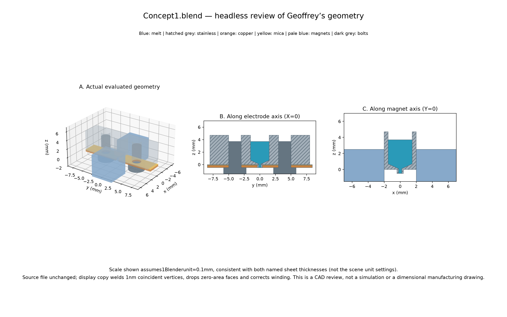

# Read-only review of Geoffrey's Concept1.blend

Source: `/home/geoffrey/Reference/OffTopic/mhd-simulator/Concept1.blend`, SHA256`c0b310a615e93488423c8f8908165c7039d75456a2dbe218f628b35098e31df4`. Read headlessly with Blender, auto-execution disabled. The source file was not edited. No physics simulation was run.

1. Scale is provisional: the scene declares metres, but the named0.1mm mica sheets measure1Blenderunit and0.4mm copper measures4units. All dimensions below assume1unit=0.1mm. Confirm before quantitative simulation.
2. The compact underside strips keep the electrode arrangement beside the outlet without tall copper busbars. Magnets sit acrossX, electrodes acrossY. Suitable current and magnet polarities give downwardJcrossB. A positiveY current and positiveX field give negativeZ force.
3. The modeled metal M2 bolts touch the copper and stainless. Without insulating sleeves/head washers or insulating bolts, there is an electrical path from each copper electrode into the broad upper stainless body, in parallel with the intended tip path. This needs explicit treatment, not merely a mica sheet under the body.
4. At the assumed scale, the tip is0.8mm square around a0.4mm outlet, leaving0.2mm minimum stainless wall. Copper bears on the opposite vertical tip sides over about0.8x0.4=0.32mm² per side. This is an edge contact rather than a large overlapping pad; burrs, fit, preload, oxidation and thermal expansion can strongly affect it. The tiny lip is also a manufacturing/mechanical concern. It should not be credited with an ideal zero-resistance contact without sensitivity/measurement.
5. The5mm cube magnets have inner faces atX=±2mm, exactly matching the stainless body's outerXfaces. They nominally touch the hot body. A real thermal gap/insulator/support is needed, and its field effect must be included. Their lower face is2mm below the outlet plane, giving a much shorter minimum flight distance than the old extended magnet arrangement, before target/carrier clearance is added. Cube-magnet field strength cannot be borrowed from the previous25x10x5mm sources.
6. Heater/sensor locations are intentionally unfinished. A heater added above or beyond the narrow head should avoid the bolt/chamber drill paths, preserve heat delivery to the tip and avoid making another conductive bridge between electrodes. No fit or heat-balance claim yet.
7. Display-only processing welded coincident vertices at1nm precision, removed zero-area/duplicate faces and consistently oriented triangle winding. This allowed section display of the evaluated Screw modifier. It is not a saved CAD repair or a simulation-ready export. The source Blender file remains unchanged; a production import should resolve its winding/degenerate faces explicitly.

